# Figures

<!-- Generated by `python -m mlipft docs` from results/ and data/; edit src/mlipft/report.py. -->

Main figures in `figures/main/`, Extended Data in `figures/extended/`, each as PDF, SVG (editable text) and 600-dpi PNG; the plotted values of every panel are in `figures/source_data/`. Rebuild with `python -m mlipft figures`.

## Fig. 1. Study design and model system

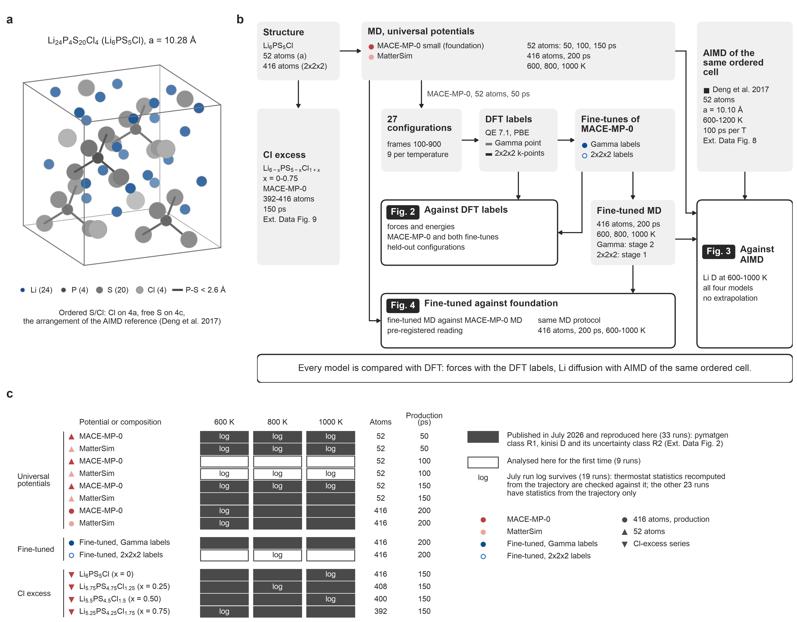

Fig. 1 | Study design and model system. **a**, The 52-atom cell of every Li6PS5Cl run (Li24P4S20Cl4, cubic, a = 10.2795 A; the lowest-Ewald-energy S/Cl ordering of the Materials Project cell), in an oblique orthographic projection; farther atoms are drawn smaller with lighter outlines, and every element keeps its fill (Cl very light with a dark outline). The S/Cl arrangement is fully ordered, Cl on 4a and the free S on 4c; the AIMD reference simulates the same arrangement. The origin is shifted by 0.18 along each axis so that the 4 PS4 tetrahedra (P-S < 2.6 A, minimum image; 16 bonds) lie inside the drawn cell. The 416-atom cell is its 2x2x2 supercell. **b**, Study design (protocol amendments A3-A5): every model is compared with DFT. Grey boxes, inputs and simulations; outlined boxes with a figure badge, the three comparisons and the figure that shows each; the banner below them states the rule they share. Against DFT labels (Fig. 2): 27 configurations (frames 100-900, 9 per source temperature) of the 52-atom, 50-ps MACE-MP-0 runs were labelled with Quantum ESPRESSO 7.1 (PBE) at the Gamma point (1 k-point) and on a 2x2x2 mesh (8 k-points); MACE-MP-0 small was fine-tuned once on each label set, and the forces and energies of the two universal potentials (MatterSim from amendment A4) and of the fine-tuned models are compared with these labels on held-out configurations. 'Gamma' and '2x2x2' denote MACE-MP-0 small fine-tuned on the Gamma-point labels (22 training and 5 validation configurations) or on the 2x2x2 labels (24 and 3); stage 1 is the best epoch before stochastic weight averaging, stage 2 the model after it. Against AIMD (Fig. 3): the 416-atom, 200-ps MD runs of all four models (the two universal potentials, MACE-MP-0 small, the foundation model, and MatterSim; the two fine-tuned models, both at stage 2, on the Gamma labels and on the 2x2x2 labels) at 600, 800 and 1000 K are compared with AIMD of the same ordered cell through the Li diffusion coefficient D at 600, 800 and 1000 K, without extrapolation. The 52-atom runs of the universal potentials (50, 100 and 150 ps), which have the cell size of the AIMD reference, are compared with it in Extended Data Fig. 4g. The AIMD reference (Deng et al., Chem. Mater. 29, 281 (2017); Extended Data Fig. 8) has 52 atoms, a = 10.10 A (a 5 % smaller volume than here), a 2-fs time step and 100 ps at each of 600, 800, 1000 and 1200 K. Fine-tuned against foundation (Fig. 4): the fine-tuned MD runs follow the protocol of the 416-atom, 200-ps MACE-MP-0 runs and are compared with them through readings fixed in advance: the labels at equal training stage, with both fine-tunes at stage 2 (amendment A5, now the primary reading), and, as first pre-registered (protocol/analysis_plan.md), with the July run on the 2x2x2 labels at stage 1; the two 2x2x2 runs give the training stage at equal labels (Fig. 4c). The Cl-excess series Li6-xPS5-xCl1+x (x = 0-0.75; 392-416 atoms, 150 ps) runs with MACE-MP-0 (Extended Data Fig. 9). Markers: colour by potential (red, the universal potentials; dark blue, the fine-tune on the Gamma labels; blue, the fine-tune on the 2x2x2 labels), fill by training stage (filled, stage 2 and the universal potentials; open, stage 1, in c only); black square, AIMD. Black and grey bars, the 2x2x2 and Gamma label sets. **c**, The 45 MD runs (n = 45: 33 published in July 2026, 9 more run in July and analysed here for the first time, 3 run here under amendment A5; 22 with a run log), one per series and temperature, grouped into the universal potentials, the fine-tuned models (named by label set and the training stage of the model that drove the MD, stage 2 first) and the Cl-excess series Li6-xPS5-xCl1+x (rows by x). Dark cells: the 33 runs published in July 2026, re-analysed here from the same trajectories; every run is in pymatgen class R1 (D identical to the published value within a relative difference of 1e-09) and in kinisi class R2 (D within max(3 s_seed, 2 %) and its standard deviation within max(3 s_seed, 10 %) of the published values, s_seed being the scatter over ten sampling seeds; protocol/reproduction_rule.md; Extended Data Fig. 2). White cells: the 9 runs made in July 2026 and analysed here for the first time (MACE-MP-0, 52 atoms, 100 ps; MatterSim, 52 atoms, 100 ps; fine-tuned on 2x2x2 labels at stage 1, 416 atoms, 200 ps). Light grey cells: the 3 runs of amendment A5 (fine-tuned on 2x2x2 labels at stage 2, 416 atoms, 200 ps), run and analysed here with the MD driver, cell and settings of the July fine-tuned runs (protocol/amendments.md). 'log': a run log was kept (22 runs: 19 from July 2026, 3 from amendment A5) and the thermostat statistics recomputed from the trajectory were checked against it; for the other 23 runs they come from the trajectory only. Markers: colour by potential and fill by training stage as in b; shape by run type (circle, 416-atom production run; triangle, 52-atom run; inverted triangle, Cl-excess series). Sources: data/structures/config0.cif, data/dft/configs.csv, data/dft/qe_runs.csv, data/references/aimd_deng2017/transport.csv, results/reproduction_runs.csv, results/thermostat.csv.

## Fig. 2. Forces against DFT

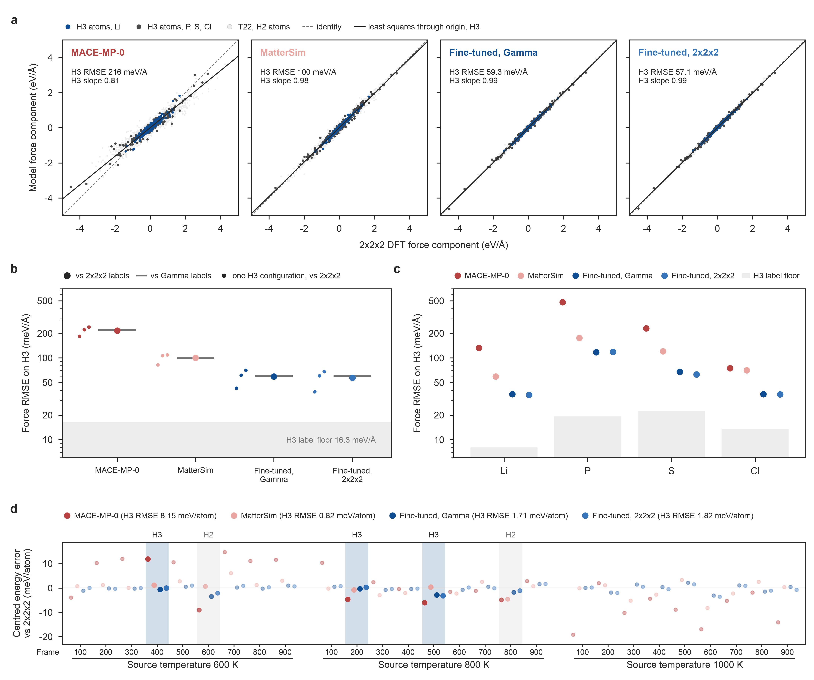

Fig. 2 | Forces against DFT. Shown are the four potentials of the main figures, MACE-MP-0 and MatterSim (universal potentials) and two fine-tunes of MACE-MP-0 small, each of which drove the MD runs of Fig. 3. H3 denotes the three configurations that neither fine-tune was trained on (frame 400 at 600 K and frames 200 and 500 at 800 K); they are the validation configurations of both fine-tunes and so were used to select the epoch. The subsets are mapped in Extended Data Fig. 5a. The reference is the 2x2x2 k-point label set unless stated. MatterSim was evaluated in float32, the precision of its MD runs, and the MACE models in float64 (protocol amendment A4). **a**, Force components predicted by the four models against the 2x2x2 labels; each point is one force component (single values, no error bars). The MACE models are those that drove the MD runs (identified by force fingerprints, Extended Data Fig. 7a); MatterSim reproduces the forces stored in its runs (four frames of each of its three production runs recomputed, RMS difference at most 0.0021 meV/A). H3 atoms are drawn in navy for Li and in dark grey for the framework atoms P, S and Cl (n = 468 force components per model; per-element errors in c); the T22 and H2 configurations are drawn in light grey behind them (T22 is training data of both fine-tunes, H2 of the 2x2x2 fine-tune). Dashed line, identity; solid line, least-squares fit through the origin on H3, whose slope measures force softening. RMSE and slope on H3: MACE-MP-0 216 meV/A and 0.81; MatterSim 100 meV/A and 0.98; Fine-tuned, Gamma 59.3 meV/A and 0.99; Fine-tuned, 2x2x2 57.1 meV/A and 0.99. **b**, Force RMSE on H3 (meV/A) of the four models: large markers against the 2x2x2 labels and grey bars against the Gamma-point labels, each over all n = 468 H3 force components; small dots, the n = 3 H3 configurations individually against the 2x2x2 labels (156 components each), left to right in the order of d. Single values, no error bars; with three configurations no confidence intervals are given. MACE-MP-0 216 (2x2x2) and 220 (Gamma); MatterSim 100 (2x2x2) and 100 (Gamma); Fine-tuned, Gamma 59.3 (2x2x2) and 60.3 (Gamma); Fine-tuned, 2x2x2 57.1 (2x2x2) and 60.3 (Gamma). Grey band, the H3 label floor (16.3 meV/A): the RMSE of the Gamma minus 2x2x2 force components over H3, the force error that separates the two label sets themselves. **c**, Force RMSE on H3 against the 2x2x2 labels per element for the four models (n = Li 216, P 36, S 180, Cl 36 force components per model); single values, no error bars. Grey bands, the per-element H3 label floor (RMSE of the Gamma minus 2x2x2 force components of that element over H3: Li 8.0, P 19.3, S 22.5, Cl 13.5 meV/A). P carries the largest error of every model (MACE-MP-0 480; MatterSim 176; Fine-tuned, Gamma 117; Fine-tuned, 2x2x2 118 meV/A). Panels b and c share a logarithmic axis. **d**, Energy error per configuration (n = 27) against the 2x2x2 labels after removing each model's constant offset, the mean error over the 22 T22 configurations (all configurations have the composition Li24P4S20Cl4); single values, no error bars. Configurations are ordered by the temperature (600, 800 or 1000 K) and frame of the 52-atom MACE-MP-0 run they were taken from; the four models are offset horizontally within each configuration. H3 configurations (dark bands) are drawn as opaque 3.0-pt markers, H2 configurations (light bands) as 2.6-pt markers at 70% opacity and T22 configurations as 2.2-pt markers at 40% opacity. RMSE on H3: MACE-MP-0 8.15; MatterSim 0.82; Fine-tuned, Gamma 1.71; Fine-tuned, 2x2x2 1.82 meV/atom (All27: 9.37, 2.93, 1.43, 1.27 in the same order). The centred errors of the universal potentials drift with source temperature (mean MACE-MP-0 +7.7, -0.4, -8.7; MatterSim +1.9, -1.0, -1.2 meV/atom at 600, 800, 1000 K). The centred energy label floor, +/-0.43 meV/atom (the RMSE over all 27 configurations of the Gamma minus 2x2x2 energies, centred in the same way), is narrower than a marker and is not drawn. 'Fine-tuned, Gamma' and 'Fine-tuned, 2x2x2' denote MACE-MP-0 small fine-tuned on the Gamma-point labels (22 training and 5 validation configurations) or on the 2x2x2 labels (24 and 3), each the model after stochastic weight averaging (stage 2); the stage-1 models are compared in Extended Data Fig. 7. Every model is compared with DFT, not with experiment. Sources: data/dft/configs.csv, results/label_floor.csv, results/cross_evaluation.csv, results/cross_evaluation_configs.csv, data/models/predictions_forces.csv.gz, data/models/predictions_mattersim_forces.csv.gz, data/models/mattersim_identity.csv, data/models/mattersim_evaluation.json, data/models/evaluation.json.

## Fig. 3. Li diffusion against AIMD

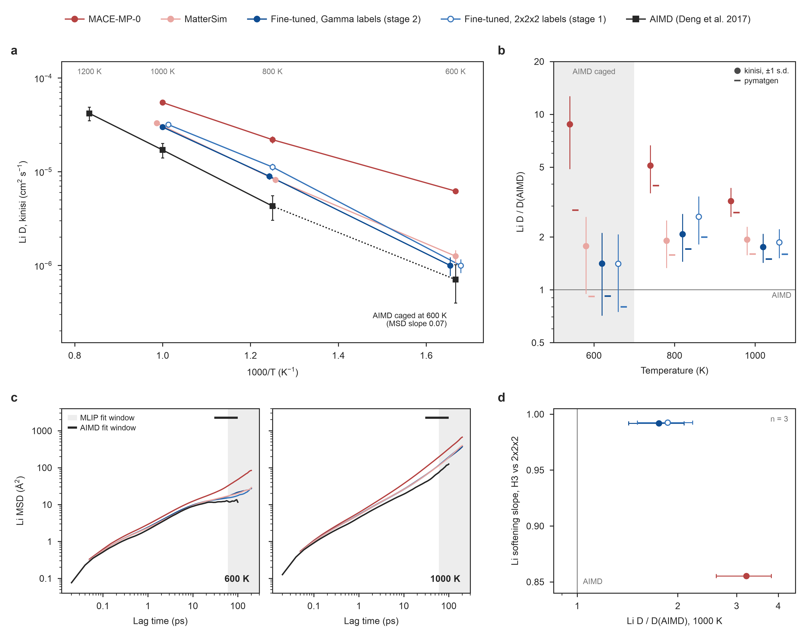

Fig. 3 | Li diffusion against AIMD. The reference is AIMD of the same ordered Li6PS5Cl cell (Cl on 4a, free S on 4c) by Deng et al., Chem. Mater. 29, 281 (2017), re-analysed with the estimators and settings of the MLIP runs (Extended Data Fig. 8). MLIP runs: 416 atoms, 200 ps per temperature, a = 10.28 A; AIMD: 52 atoms, 100 ps, a = 10.10 A. One trajectory per model and temperature. Both fine-tuned runs use the stage-two models (the 2x2x2 run is that of amendment A5, protocol/amendments.md; the July run of the stage-one 2x2x2 model is compared in Fig. 4c). Every D is the kinisi estimate (seed 0, fitted from a lag of 30 % of each run onwards); error bars, +/- 1 posterior s.d. **a**, Li D against 1000/T of the production runs at 600, 800 and 1000 K (circles joined by lines; so that markers do not overlap, the Gamma and 2x2x2 fine-tuned points are offset horizontally by -0.02 and +0.02 in 1000/T, while MACE-MP-0, MatterSim and AIMD points sit at their true 1000/T) and of AIMD at 600-1200 K (black squares; 600 K, 7.1e-7 +/- 3.1e-7; 800 K, 4.3e-6 +/- 1.3e-6; 1000 K, 1.7e-5 +/- 3.0e-6; 1200 K, 4.2e-5 +/- 7.0e-6 cm2/s). At 600 K the AIMD Li MSD is almost flat in the fit window (log-log slope 0.071): that point measures caged motion, not long-range diffusion (dotted segment). **b**, kinisi D of each production run divided by the AIMD D at the same temperature (circles; error bars, the two relative standard deviations added in quadrature) and the pymatgen D ratio (short bars to the right of each circle). At 800 / 1000 K: MACE-MP-0 5.1 / 3.2, MatterSim 1.9 / 1.9, Gamma fine-tune 2.1 / 1.8, 2x2x2 fine-tune 2.9 / 1.7. Grey column, 600 K, where AIMD is caged. **c**, Li mean-squared displacement against lag time at 600 and 1000 K, averaged over all time origins, one trajectory each (single curves, no error bars); grey band, the MLIP fit window (lag >= 60 ps); black bar, the AIMD fit window (lag >= 30 ps). The key in each panel gives the log-log slope in the fit window (1 for diffusive motion); at 600 K: MACE-MP-0 0.826, MatterSim 0.403, Gamma fine-tune 0.354, 2x2x2 fine-tune 0.373, AIMD 0.0708; at 1000 K: MACE-MP-0 1.04, MatterSim 1.07, Gamma fine-tune 0.949, 2x2x2 fine-tune 0.943, AIMD 0.998. **d**, Li force softening slope of each of the four models (least-squares slope through the origin of model against 2x2x2 DFT Li force components on the 3 configurations not trained on by either fine-tune, H3, which are the validation configurations of both; 216 components) against its kinisi D ratio to AIMD at 1000 K (logarithmic axis; error bars as in b; the slope is a single value without error bar). Slope and ratio: MACE-MP-0 0.855 and 3.21, MatterSim 1.01 and 1.93, Gamma fine-tune 0.992 and 1.76, 2x2x2 fine-tune 0.981 and 1.66. n = 4 models, no fit. The 52-atom runs and a second 416-atom MACE-MP-0 run are in Extended Data Fig. 4. Sources: data/md/transport.csv, data/md/msd.csv.gz, data/references/aimd_deng2017/transport.csv, data/references/aimd_deng2017/msd.csv.gz, results/aimd_comparison.csv, results/cross_evaluation.csv.

## Fig. 4. What fine-tuning changes

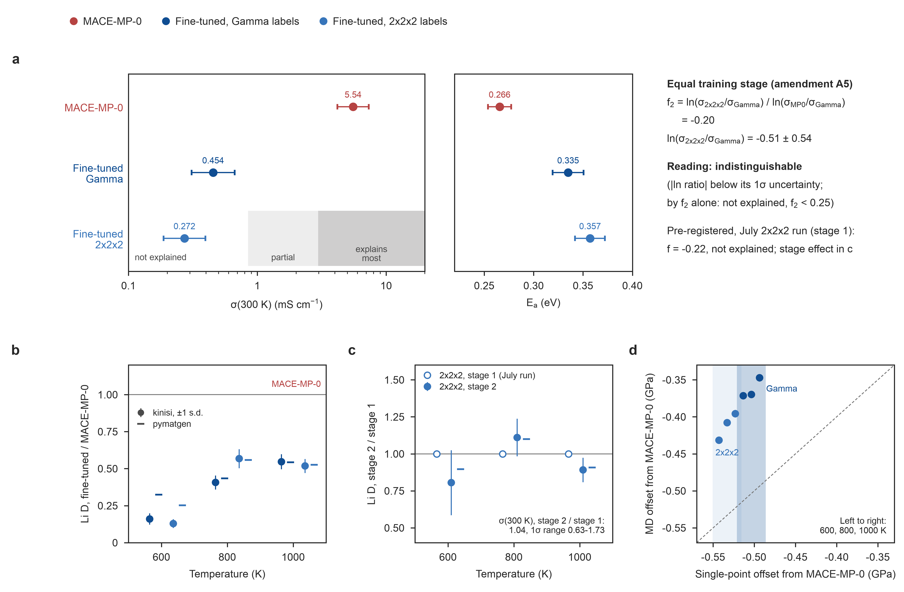

Fig. 4 | What fine-tuning changes. MD values are re-analysis values of the 416-atom, 200-ps runs at 600, 800 and 1000 K of MACE-MP-0 small (the foundation) and of its fine-tunes on DFT labels of the 27 configurations. 'Gamma' and '2x2x2' denote MACE-MP-0 small fine-tuned on the Gamma-point labels (22 training and 5 validation configurations) or on the 2x2x2 labels (24 and 3); stage 1 is the best epoch before stochastic weight averaging, stage 2 the model after it. In a, b and d the two fine-tuned runs are those of the stage-2 Gamma model and the stage-2 2x2x2 model (the run of amendment A5, protocol/amendments.md), so the two fine-tunes differ only in their labels; c adds the July 2x2x2-label run, which used the stage-1 2x2x2 model (models identified by force fingerprints, Ext. Data Fig. 7a). Filled markers, foundation or stage 2; open markers, stage 1. Every comparison here is model against model or model against DFT; the comparison of the same runs with AIMD is in Fig. 3, and the force errors of the models of both stages are in Ext. Data Fig. 7b. **a**, sigma(300 K) (logarithmic axis; bars, 1-sigma interval from the fit covariance) and Ea (+/- 1 s.d.) of the weighted Arrhenius fits of ln(sigma T) against 1/T (pymatgen D, n = 3 temperatures, 600-1000 K): MACE-MP-0 5.54 [4.18, 7.33] mS/cm and Ea 0.266 +/- 0.012 eV; Gamma-label run 0.454 [0.309, 0.667] mS/cm and Ea 0.335 +/- 0.016 eV; 2x2x2-label run 0.272 [0.187, 0.395] mS/cm and Ea 0.357 +/- 0.015 eV. Right, the reading fixed in the analysis plan (protocol/analysis_plan.md, part C) taken at equal training stage, which amendment A5 made the primary reading: f2 = ln(sigma_2x2x2/sigma_Gamma)/ln(sigma_MP0/sigma_Gamma) is the fraction of the fine-tuning slowdown recovered with the 2x2x2 labels (MP0, the foundation run); f2 < 0.25 reads 'not explained', f2 > 0.75 'explains most', otherwise 'partial', and the two fine-tunes are 'indistinguishable' if |ln(sigma_2x2x2/sigma_Gamma)| is below its 1-sigma uncertainty (the half-widths of the two log intervals in quadrature). f2 = -0.20 and ln(sigma_2x2x2/sigma_Gamma) = -0.51 +/- 0.54: sigma_2x2x2 lies below sigma_Gamma, on the side away from the foundation, and |ln(sigma_2x2x2/sigma_Gamma)| is below its 1-sigma uncertainty. The reading is 'indistinguishable' (f2 < 0.25 alone would read 'not explained'). Grey zones in the 2x2x2 row: where sigma_2x2x2 would have had to lie for 'partial' (0.848-2.96 mS/cm) or 'explains most' (above 2.96 mS/cm). The pre-registered reading, made with the July 2x2x2-label run of the stage-1 model, stays reported as such: f = -0.22 and ln(sigma_2x2x2/sigma_Gamma) = -0.56 +/- 0.51, 'not explained'; it compares fine-tunes of different training stages, whose effect is shown in c. **b**, kinisi D of each fine-tuned run divided by that of the foundation run at the same temperature (circles; error, the two kinisi relative standard deviations in quadrature; one run per model and temperature) and the pymatgen D ratio (short bars to the right of the circles). At 600, 800 and 1000 K: Gamma-label run 0.161 +/- 0.039, 0.407 +/- 0.047, 0.547 +/- 0.051; 2x2x2-label run 0.129 +/- 0.029, 0.568 +/- 0.065, 0.519 +/- 0.047 (pymatgen: Gamma-label run 0.324, 0.435, 0.543; 2x2x2-label run 0.252, 0.559, 0.526). Fine-tuning lowers the kinisi D to 0.13-0.57 of the foundation's. Compared directly (the foundation cancels), kinisi D of the 2x2x2 run divided by that of the Gamma run is 0.804 +/- 0.25, 1.40 +/- 0.15, 0.947 +/- 0.089 at 600, 800 and 1000 K, at most 2.6 standard deviations from 1 (at 800 K). **c**, Training stage at equal labels (amendment A5, descriptive): kinisi D of the stage-2 2x2x2-label run divided by that of the July stage-1 run at the same temperature (filled circles; error, the two kinisi relative standard deviations in quadrature; open circles, the stage-1 run, 1 by construction) and the pymatgen D ratio (short bars): 0.806 +/- 0.22, 1.11 +/- 0.13, 0.892 +/- 0.082 at 600, 800 and 1000 K (pymatgen: 0.896, 1.10, 0.907); the kinisi ratios differ from 1 by at most 1.3 standard deviations. The stage-1 run gives sigma(300 K) 0.260 [0.186, 0.365] mS/cm and Ea 0.360 +/- 0.014 eV; the ratio of sigma(300 K), stage 2 over stage 1 (bottom right), is 1.04 (1-sigma range 0.63-1.73), and its logarithm, 0.043, lies below its 1-sigma uncertainty of 0.50 (the half-widths of the two log intervals in quadrature). **d**, Pressure offset of each fine-tuned MD model from the foundation. Horizontal, the DFT single points: model pressure minus MACE-MP-0 pressure on the same configuration, averaged over all 27 configurations (paired; shaded bands in the model colour, mean +/- standard error of the paired differences, n = 27): Gamma -0.504 +/- 0.017 GPa; 2x2x2 -0.533 +/- 0.017 GPa. The DFT pressure cancels in the difference; the mean pressure errors against the 2x2x2 labels are MACE-MP-0 +0.064; Gamma -0.440; 2x2x2 -0.469 GPa. Vertical, MD: mean pressure of the fine-tuned run minus that of the foundation run at the same temperature, with the standard errors of the two run means from 0.5-ps block averages (n = 400 blocks per run) added in quadrature (at most 0.0051 GPa, mostly hidden by the markers): Gamma -0.371, -0.370, -0.347; 2x2x2 -0.432, -0.408, -0.396 GPa at 600, 800 and 1000 K. The three temperatures of one model share their horizontal value and are drawn left to right in that order, offset by +/- 0.01 GPa for clarity. Dashed line, identity. Absolute mean MD pressures at 600, 800 and 1000 K (GPa): MACE-MP-0 -0.357, -0.023, +0.339; Gamma -0.728, -0.393, -0.008; 2x2x2 -0.788, -0.431, -0.056. Both fine-tunes lower the pressure, in the single points and in MD; the 2x2x2 model lowers both more. No model was trained on stress, so pressures are diagnostic; the DFT configurations come from the 52-atom MACE-MP-0 MD at 600, 800 and 1000 K, in the cell of which the 416-atom cell is the 2x2x2 supercell, and every MD run keeps that cell fixed (pressure time series in Extended Data Fig. 1). Sources: results/transport_comparison.csv, results/transport_ratios.csv, data/md/transport.csv, results/cross_evaluation.csv, results/cross_evaluation_configs.csv, results/thermostat.csv, data/md/timeseries.csv.gz, data/dft/configs.csv.

## Extended Data Fig. 1. Temperature, energy and pressure of every MD run

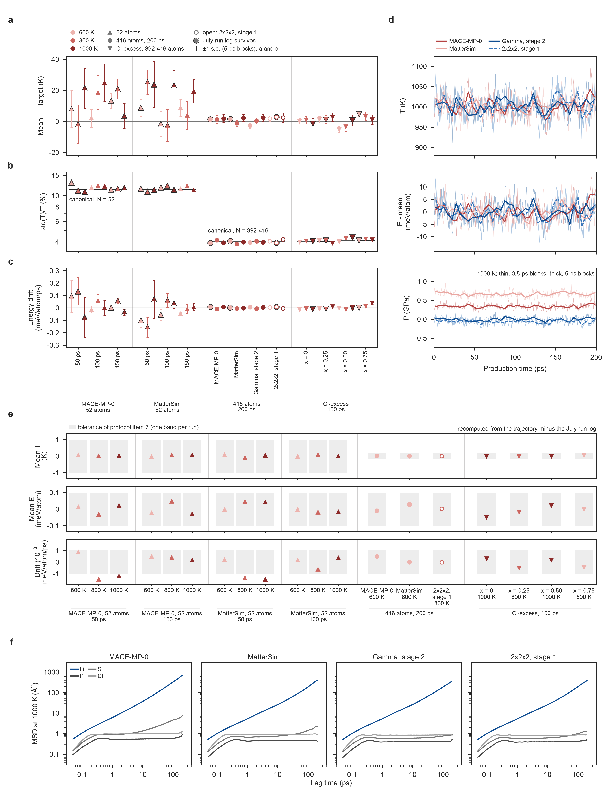

Extended Data Fig. 1 | Temperature, energy and pressure of every MD run. All 45 runs (15 series, each at 600, 800 and 1000 K; Langevin thermostat, 1 fs step); the series are those of Fig. 1c. In a-c and e, colour is the target temperature, marker shape the run type (triangles, 52-atom cells; circles, the 416-atom, 200-ps production runs; inverted triangles, the 392-416-atom Cl-excess runs of 150 ps), and open markers are the July runs of the 2x2x2-label fine-tune, whose MD used its stage-1 model; every other run is filled, including the runs of its stage-2 model (protocol amendment A5). In a-c, a black outline marks the runs with a run log (22 of 45: the 19 whose July log survives and the 3 runs of amendment A5); the statistics of the other 23 come from the trajectory only. Instantaneous temperature from the kinetic energy with 3N degrees of freedom; pressure -tr(stress)/3 + N k_B T / V. 'Gamma' and '2x2x2' are the MACE-MP-0 fine-tunes on the two DFT label sets; x is the Cl excess of Li(6-x)PS(5-x)Cl(1+x). **a**, Mean temperature minus the target, n = 45 runs. Error bars, standard error of the mean from 5-ps block averages (the standard deviation of the 10-40 block means of a run divided by the square root of their number). The 52-atom runs lie on average +12.2 K (+1.5 %) from the target (range -2.5 to +25.3 K; 6 of 18 more than two standard errors above it and 0 below), the 392-416-atom runs +0.6 K (+0.1 %; range -5.2 to +4.6 K; 2 of 27 beyond two standard errors). **b**, Relative temperature fluctuation std(T)/T of each run (n = 45; the standard deviation of the instantaneous temperature over the production run, no error bars) against the canonical value sqrt(2/(3N)) (black bars, for the atom count of each series; logarithmic axis). The ratio of the two is 0.95-1.15 over all runs. **c**, Drift of the potential energy per atom (n = 45), the slope of a straight-line fit against time over the production run. Error bars, standard error of that slope from 5-ps block averages; 4 of 45 drifts exceed two standard errors (largest 0.156 meV/atom/ps). **d**, Temperature, potential energy per atom (minus its run mean) and pressure of the 416-atom, 200-ps production runs at 1000 K (n = 5 runs; colour, the model that drove the run; thick dashed line, 2x2x2, stage 1), as 0.5-ps block means (thin lines) and 5-ps block means (thick lines); single runs, no error bars; temperature 910-1096 K; dashed lines, the target temperature and the run mean of the energy. Mean pressure: +0.34 (MACE-MP-0), +0.67 (MatterSim), -0.01 (Gamma, stage 2), -0.06 (2x2x2, stage 1) and -0.06 (2x2x2, stage 2) GPa. **e**, Statistics recomputed from the trajectories minus the values in the run logs, for the n = 22 runs with a log (single values, no error bars). Grey bands, the tolerance of protocol item 7: |d mean T| <= 1 K for 52 atoms and 0.2 K for 392-416 atoms (the logs include one extra sample at step 0 and round to 0.1 K); mean energy and drift within one unit of the logged rounding (10^-4 eV/atom and 10^-3 meV/atom/ps). The mean temperature agrees in 22 of 22 runs and the mean energy in 22 of 22. The drift agrees in 18 of 22; it does not in 4 52-atom, 50-ps runs (MACE-MP-0 800 K, MACE-MP-0 1000 K, MatterSim 800 K, MatterSim 1000 K; the markers below the band), which differ by 1.20-1.49 x 10^-3 meV/atom/ps. The logged fit also includes the production starting frame, which the trajectory does not store; in a 52-atom run this one end point moves the 50-ps slope by about 10^-3 meV/atom/ps. The check is reported as failed, as the rule states. **f**, Mean-squared displacement of Li, P, S and Cl in the production runs at 1000 K (n = 5 runs, one per axes, titled with the model that drove it; averaged over all time origins and atoms of an element, centre-of-mass drift removed; no error bars). At the longest lag (199.95 ps, a single time origin) Li reaches at least 351 A^2, P at most 0.88 A^2 and Cl at most 1.32 A^2: the P framework and the Cl sublattice stay in place. S reaches 7.38 (MACE-MP-0), 2.14 (MatterSim), 0.90 (Gamma, stage 2), 1.36 (2x2x2, stage 1) and 1.16 (2x2x2, stage 2) A^2; S moving further than P is consistent with reorientation of PS4 tetrahedra about fixed P. Sources: results/thermostat.csv, data/md/timeseries.csv.gz, data/md/msd.csv.gz, results/cross_evaluation.csv.

## Extended Data Fig. 2. Re-analysis against the values published in July 2026

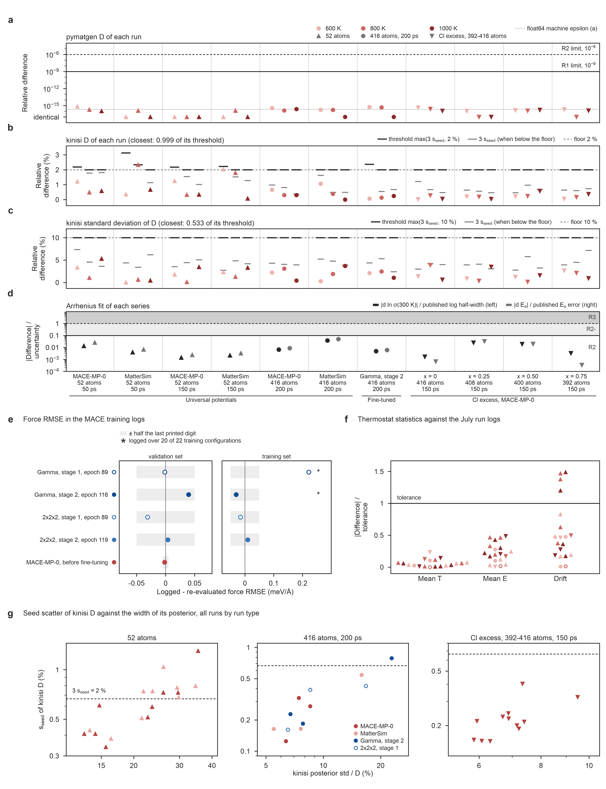

Extended Data Fig. 2 | Re-analysis against the values published in July 2026. The comparison follows a rule committed before any trajectory was re-analysed (protocol/reproduction_rule.md), applied to the 33 published runs of 11 series (x axis of a-d: series in the order of Fig. 1c, three runs each at 600, 800 and 1000 K). In a-d, f and g, marker shape is the run type (triangles, 52-atom cells; circles, the 416-atom, 200-ps production runs; inverted triangles, the 392-416-atom Cl-excess runs of 150 ps) and open markers (f, g) are the July runs of the 2x2x2-label fine-tune, whose MD used its stage-1 model (every other run is filled, including the runs of its stage-2 model, protocol amendment A5); in a-c and f colour is the temperature. **a**, Relative difference between the re-analysed and the published pymatgen D of each run (n = 33; one value per run, no error bars). In 12 runs the two are bit-identical (drawn on the 'identical' row, at 1e-17); the others differ by 1.1e-16-7.3e-16, a few float64 rounding steps (dotted line, machine epsilon 2.22e-16). Solid line, the R1 limit (1e-9); dashed line, the R2 limit (1e-6). Classes: R1 for every run in D and in sigma. **b**, Relative difference of the kinisi D (seed 0 here, an unseeded sampler in July) and **c**, of its kinisi standard deviation (n = 33 runs each), with each run's threshold max(3 s_seed, 2 %) and max(3 s_seed, 10 %) (black bars), where s_seed is the relative standard deviation over seeds 1-10 (n = 10; grey bars, 3 s_seed when below the floor; dashed line, the floor); single values, no error bars. Within the threshold: 33 of 33 runs in b and 33 of 33 in c (class R2). The closest is MatterSim, 52 atoms, 50 ps, 800 K, in b (2.331 % against 2.332 %, 0.9994 of the threshold) and MACE-MP-0, 52 atoms, 50 ps, 1000 K, in c (0.533 of the threshold); in c, 3 s_seed never exceeds 7.36 %, so the 10 % floor sets every threshold. **d**, The n = 11 Arrhenius fits (one per series, three temperatures each) re-done with the re-analysed values: |d ln sigma(300 K)| in units of the published log half-width of the 1-sigma interval (black, left of each series) and |d Ea| in units of the published Ea error (grey, right); single values, no error bars. Light band, R2-; darker band, R3. Solid line, the R2 limit (0.1); dashed line, the R2- limit (1). Classes: R2; the largest difference is 0.050 (MatterSim, 416 atoms, 200 ps). The published values are therefore quoted for these series (rule item 2). **e**, Force RMSE written in the MACE training logs minus the same error re-evaluated from the model files (meV/A), on the validation set (n = 5 models) and on the training set (n = 4; MACE-MP-0 has no training log), for the four fine-tuned models (navy, Gamma labels; blue, 2x2x2 labels; stage 1 open, stage 2 filled; the marker beside each row name repeats its style) and the foundation model before fine-tuning (validation set of the Gamma fine-tune); single values, no error bars. Grey bands, half the last printed digit. Validation errors agree to within 0.040 meV/A. The logged training errors of the Gamma fine-tune (asterisks) cover 20 of its 22 training configurations because MACE drops the last incomplete batch (protocol amendment A1); against all 22 they differ by +0.22 and -0.03 meV/A, and 11 (stage 1) and 21 (stage 2) of the 231 subsets of 20 configurations reproduce the logged values exactly. **f**, Thermostat statistics recomputed from the trajectory against the n = 22 run logs (the 19 July logs that survive, 4 of them from runs never analysed in July, and the 3 of amendment A5; per run in Extended Data Fig. 1e): absolute difference in units of the tolerance of the rule (0.2 K for 392-416 atoms and 1 K for 52 atoms for the mean temperature; one unit of the logged rounding, 0.0001 eV/atom and 0.001 meV/atom/ps, for the mean energy and the drift; markers spread sideways within each column so that none overlap; single values, no error bars). The mean temperature agrees in 22 of 22 runs and the mean energy in 22 of 22; the drift agrees in 18 of 22. The 4 drift values outside the tolerance (MACE-MP-0, 52 atoms, 50 ps, 800 K; MACE-MP-0, 52 atoms, 50 ps, 1000 K; MatterSim, 52 atoms, 50 ps, 800 K; MatterSim, 52 atoms, 50 ps, 1000 K; at most 0.0015 meV/atom/ps) are all from 52-atom, 50-ps runs, where the logged fit also includes the starting frame that the trajectory does not store; the check is reported as failed, as the rule states. **g**, Monte-Carlo scatter of kinisi D, s_seed (relative standard deviation of D over seeds 1-10, n = 10 per run; seed 0 is the primary value), against the relative width of the kinisi posterior (posterior standard deviation over D, seed 0), for all n = 45 runs, in one panel per run type with its own axis ranges (colour, the model that drove the run); single values, no error bars. The rule accepts a kinisi D within max(3 s_seed, 2 %); above the dashed line (s_seed = 0.667 %, where 3 s_seed = 2 %) the seed term sets the threshold, which is the case in 10 of 45 runs (9 of the 18 52-atom runs and fine-tuned on Gamma labels, 416 atoms, 200 ps, 600 K). s_seed is 0.12-1.30 %, 0.020-0.055 times the posterior width. Sources: results/reproduction_runs.csv, results/reproduction_fits.csv, results/thermostat.csv, data/models/log_reproduction.csv, data/dft/configs.csv, data/md/transport.csv, data/md/kinisi_seeds.csv, results/cross_evaluation.csv, protocol/reproduction_rule.md, protocol/amendments.md.

## Extended Data Fig. 3. Arrhenius fits of every series

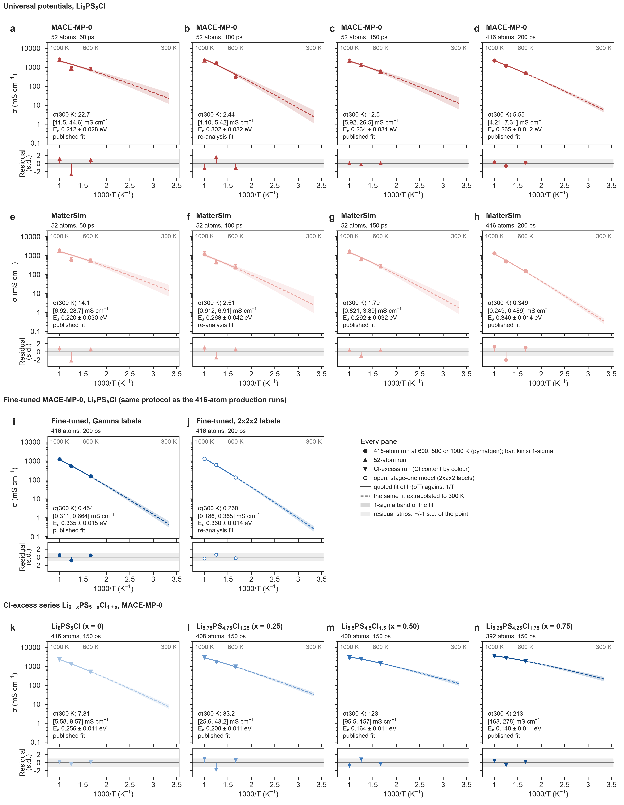

Extended Data Fig. 3 | Arrhenius fits of every series. One panel per MD series (n = 3 runs each, one per temperature), grouped by part of the protocol. **a**, **b**, **c**, MACE-MP-0 in 52-atom cells run for 50, 100 and 150 ps (independent trajectories) and **d**, its 416-atom, 200-ps production runs; **e**, **f**, **g**, **h**, the same for MatterSim (the universal potentials on Li6PS5Cl); **i**, MACE-MP-0 fine-tuned on the Gamma labels (stage-two model), **j**, on the 2x2x2 labels with the stage-one model (the July run) and **k**, with the stage-two model (amendment A5), all three under the production protocol; **l**, **m**, **n**, **o**, the Cl-excess series Li(6-x)PS(5-x)Cl(1+x) under MACE-MP-0 with x = 0.00, 0.25, 0.50, 0.75 (summarised in Extended Data Fig. 9; in these four panels the blues encode Cl content, light to dark for x = 0.00, 0.25, 0.50, 0.75, and are unrelated to the blues of the fine-tuned models, which never share a panel with them). Markers, conductivity of each run at 600, 800 and 1000 K from the pymatgen diffusion coefficient (Nernst-Einstein, no Haven ratio); colour, model (Cl content for the Cl-excess series); shape, run type (circle, 416-atom production run; triangle, 52-atom run; inverted triangle, Cl-excess run); open, the stage-one model. Error bars, the kinisi 1-sigma uncertainty, whose ratio to sigma weights the fit of ln(sigma T) against 1/T. Line, the quoted fit (solid over the simulated range, dashed where extrapolated to 300 K) with its 1-sigma band from the fit covariance; the value printed in each panel is sigma(300 K) with its 1-sigma interval and Ea with its 1-sigma error. The temperatures of the outer data columns and of the extrapolation target are written above the data. The quoted fit is the published one for every series analysed in July 2026 and the re-analysis otherwise (MACE-MP-0, 52 atoms, 100 ps; MatterSim, 52 atoms, 100 ps; fine-tuned on 2x2x2 labels (stage one), 416 atoms, 200 ps; fine-tuned on 2x2x2 labels (stage two), 416 atoms, 200 ps). Strips, residual ln sigma minus the quoted fit at each temperature in units of that point's ln-space uncertainty (kinisi standard deviation over sigma, from the re-analysis also for the published fits); grey band, +/-1. With three temperatures and two parameters each fit has one degree of freedom; the largest residual is -2.68 (MACE-MP-0, 52 atoms, 50 ps, 800 K). Shared logarithmic conductivity axis in all panels. Sources: results/fits.csv, data/md/transport.csv.

## Extended Data Fig. 4. Sampling and estimator checks

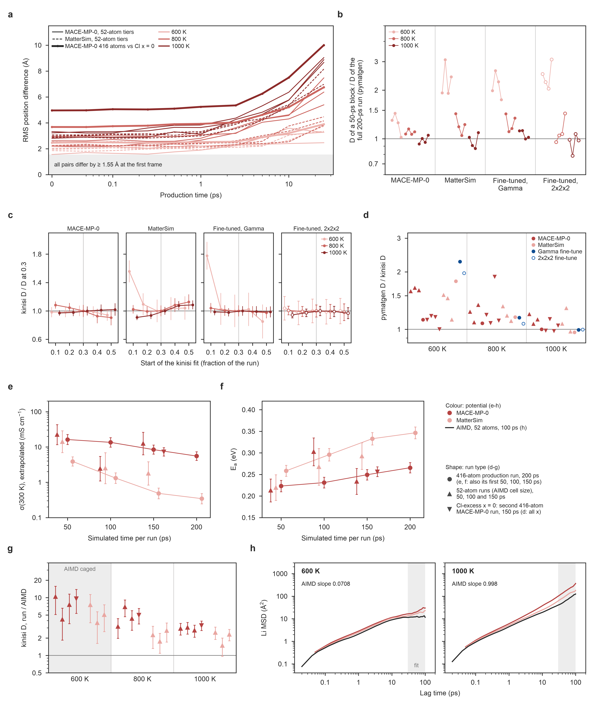

Extended Data Fig. 4 | Sampling and estimator checks. Every run is a single trajectory per temperature; D is the Li tracer diffusion coefficient. **a**, Root-mean-square difference of the atomic positions between two runs with the same potential, cell and temperature, against production time (n = 21 pairs: 18 among the 52-atom runs of 50, 100 and 150 ps, three per universal potential and temperature, and the 416-atom, 200-ps MACE-MP-0 production run against the 416-atom Cl-excess x = 0 run at each temperature, thick lines). Positions are stored at frames 0, 1, 2, 5, 10, 20, 50, 100, 200 and 500 (one frame every 50 fs); the axis is linear below 0.05 ps and logarithmic above. At the first production frame the pairs already differ by 1.55-3.32 A (52 atoms) and 2.46-4.96 A (416 atoms), and by 2.46-10.00 A after 25 ps, so the runs are independent trajectories and not extensions of one another. Single values, no error bars. **b**, pymatgen D of the 4 consecutive 50-ps blocks of each 416-atom, 200-ps production run divided by the value from the full run (n = 60 blocks of the 15 runs, 5 production series at 3 temperatures; one group per series, blocks in time order from left to right; logarithmic axis; pymatgen gives no uncertainty, so no error bars). Both 2x2x2 runs are shown and named by the training stage of the model that drove their MD: open markers, stage 1 (the July run); filled, stage 2 (the run of amendment A5; the Gamma run also used its stage-two model). Fill marks the training stage, as in every figure. The ratio is 1.02-3.28 at 600 K; 0.83-1.44 at 800 K; 0.78-1.14 at 1000 K. At 600 K the slower models give block values well above the full-run value, i.e. pymatgen D still depends on the length of the analysed window there. **c**, kinisi D of the same runs with the fit window starting at 10, 20, 30, 40 and 50 % of the run, divided by the primary value (start at 30 %, grey line; n = 5 starts for each of 15 runs; one facet per production series); error bars, kinisi posterior standard deviation divided by the same primary value; markers as in b, the 3 temperatures offset horizontally. Above 600 K the ratio stays within 0.91-1.13; the largest change is 1.78 (fine-tuned on Gamma labels (stage two), 416 atoms, 200 ps, 600 K, start 0.1). **d**, pymatgen D divided by kinisi D for all 45 runs (grey line, equality; logarithmic axis; single values, no error bars: the kinisi posterior standard deviation is 5-35 % of D). Colour, potential (key in the panel); circles, the 416-atom production runs; triangles, the 52-atom runs; inverted triangles, the 12 runs of the four 150-ps Cl-excess series of MACE-MP-0 (x = 0-0.75, Extended Data Fig. 9). Within each temperature, from left: MACE-MP-0 52-atom runs of 50, 100 and 150 ps, production run and Cl-excess runs x = 0, 0.25, 0.5 and 0.75, then MatterSim 52-atom runs and production run, then the fine-tunes: Gamma labels (stage 2) and 2x2x2 labels with the stage-1 (open) and the stage-2 model. The ratio is 1.00-2.26 at 600 K; 1.06-1.89 at 800 K; 0.96-1.29 at 1000 K (largest 2.26, fine-tuned on Gamma labels (stage two), 416 atoms, 200 ps, 600 K). **e**, sigma(300 K) extrapolated from weighted Arrhenius fits of the pymatgen conductivity at 600, 800 and 1000 K (re-analysis fits, weights from the kinisi relative standard deviation; Extended Data Fig. 3 shows the quoted fit of each series, which equals the published fit for the published series) against simulated time per run (n = 15 fits, each on 3 runs); error bars, the 1-sigma interval propagated from the fit covariance. Triangles, the 52-atom runs (MACE-MP-0 22.5, 2.44, 12.5 and MatterSim 14.1, 2.51, 1.79 mS/cm at 50, 100 and 150 ps); circles joined by lines, the 416-atom production run truncated to its first 50, 100 and 150 ps and in full (MACE-MP-0 16.3, 13.5, 8.43, 5.54, MatterSim 3.90, 1.31, 0.485, 0.344 mS/cm); inverted triangle, the second 416-atom MACE-MP-0 run (Cl-excess x = 0, 150 ps, 7.30 mS/cm). The truncated windows are nested parts of one trajectory, and markers at the same simulated time are offset horizontally. **f**, Activation energy of the same fits; error bars, 1 standard deviation of the fitted slope (production windows: MACE-MP-0 0.223, 0.231, 0.249, 0.266 eV, MatterSim 0.258, 0.296, 0.333, 0.346 eV; 52-atom runs 0.213-0.302 eV). **g**, kinisi D (seed 0, fitted from 30 % of the run) of the 52-atom runs, which have the 52-atom cell of the AIMD reference (Extended Data Fig. 8; lattice parameter 10.28 A here against 10.10 A, a 5.14 % smaller AIMD volume), and of the second 416-atom MACE-MP-0 run, divided by the AIMD kinisi D at the same temperature (n = 21 ratios); error bars, the ratio times the two relative standard deviations added in quadrature. Within each temperature, from left: MACE-MP-0 52-atom runs of 50, 100 and 150 ps and the second 416-atom run, then MatterSim 52-atom runs of 50, 100 and 150 ps. At 800 and 1000 K the 52-atom runs give 2.72-6.90 (MACE-MP-0) and 1.48-2.68 (MatterSim), the second run 3.32-5.02; the production runs are compared in Fig. 3. Grey column, at 600 K the AIMD Li MSD is almost flat in the fit window (log-log slope 0.0708): those ratios compare caged motion, not diffusion coefficients (Extended Data Fig. 8 shows all AIMD temperatures). **h**, Li mean-squared displacement against lag time at 600 and 1000 K (all time origins, centre-of-mass drift removed) of AIMD (black) and of the 100-ps, 52-atom runs that match the AIMD length and cell (one trajectory each; log-log slope in the fit window 0.641 and 0.997 for MACE-MP-0 and 0.404 and 0.866 for MatterSim at 600 and 1000 K; AIMD slope printed in each panel). Grey, the kinisi fit window of all three (lags from 30 ps). Single curves, no error bars. Sources: data/md/divergence.csv, data/md/windows.csv, data/md/transport.csv, results/convergence.csv, results/aimd_comparison.csv, data/references/aimd_deng2017/transport.csv, data/references/aimd_deng2017/msd.csv.gz, data/md/msd.csv.gz.

## Extended Data Fig. 5. The two DFT label sets

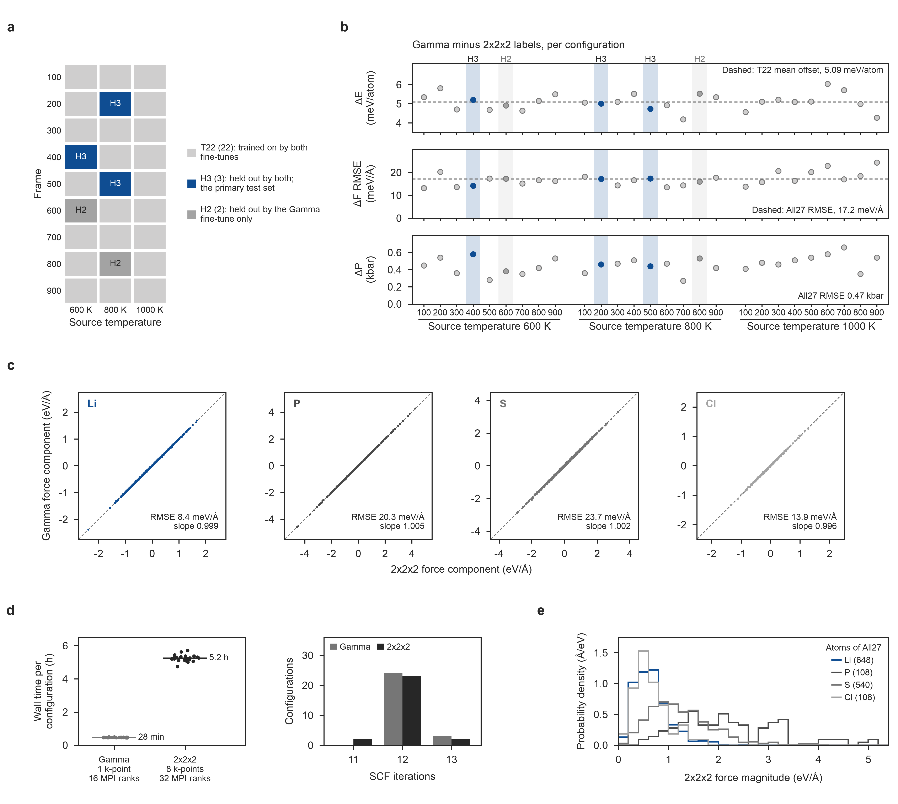

Extended Data Fig. 5 | The two DFT label sets. Both sets label the same 27 configurations with Quantum ESPRESSO 7.1 (GBRV ultrasoft PBE pseudopotentials, 60/480 Ry, Gaussian smearing 0.01 Ry, convergence threshold 1e-7 Ry) and differ only in the k-point sampling: Gamma point only, or a 2x2x2 Monkhorst-Pack mesh (taken as the reference). **a**, The 27 labelled configurations, frames 100-900 of the 52-atom, 50-ps MACE-MP-0 runs at 600, 800 and 1000 K, by subset: T22, trained on by both fine-tunes (n = 22); H3, trained on by neither (n = 3: T600_f400, T800_f200, T800_f500), the validation configurations of both fine-tunes, which therefore took part in selecting their epochs, and the subset of the primary comparison; H2, validation configurations of the Gamma fine-tune and training configurations of the 2x2x2 fine-tune (n = 2). No 1000 K configuration is outside the training data. **b**, Gamma minus 2x2x2 for each of the 27 configurations, ordered by source temperature and frame (every other frame labelled) and coloured by subset as in a (H3 and H2 columns shaded): energy per atom (4.18 to 6.04 meV/atom; dashed line, the mean offset over T22, 5.09 meV/atom, which the energy comparisons subtract; centred RMSE over All27 0.43 meV/atom), force RMSE over all components of a configuration (dashed line, the All27 value 17.2 meV/A; Fig. 2 uses the H3 value; largest 24.3 meV/A for T1000_f900) and pressure (RMSE 0.47 kbar; the Gamma pressure is the higher one for every configuration). Single values per configuration, no error bars. **c**, Gamma against 2x2x2 force components of all atoms of the 27 configurations, by element (n = 648 Li, 108 P, 540 S, 108 Cl atoms, three components each); RMSE (meV/A) and least-squares slope through the origin: Li 8.4 (slope 0.999), P 20.3 (slope 1.005), S 23.7 (slope 1.002), Cl 13.9 (slope 0.996). Dashed line, identity; no error bars. **d**, Cost of the SCF single points: wall time of each configuration (n = 27 per label set; horizontal line, median: 28 min with 1 k-point on 16 MPI processes; 5.2 h with 8 k-points on 32 processes; 200 and 4525 core-hours for the 27 configurations) and the number of SCF iterations (12-13 and 11-13); single values, no error bars. The 2x2x2 wall and CPU times are printed by Quantum ESPRESSO in hours and minutes, so they are resolved to 1 min. **e**, Distribution of the 2x2x2 force magnitudes per element over the 27 configurations (bins of 0.2 eV/A; atoms per element in the legend; mean Li 0.68, P 2.22, S 1.26, Cl 0.66 eV/A); the Gamma distributions are indistinguishable at this scale (mean magnitudes differ by at most 11.4 meV/A); no error bars. Sources: data/dft/configs.csv, data/dft/qe_runs.csv, data/dft/pseudopotentials.csv, results/label_floor.csv, results/label_floor_configs.csv, data/models/predictions_forces.csv.gz.

## Extended Data Fig. 6. Training records of the two fine-tunes

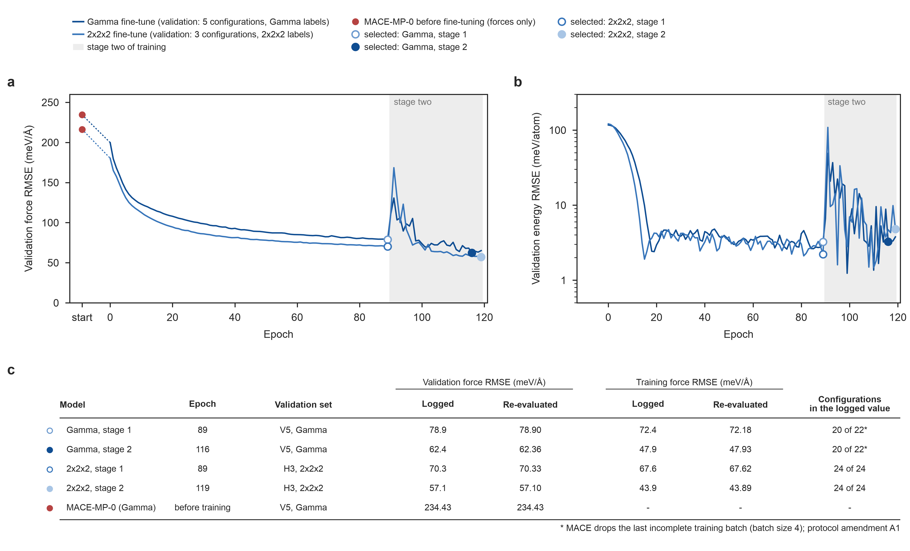

Extended Data Fig. 6 | Training records of the two fine-tunes. Both start from MACE-MP-0 small with the same settings (batch size 4; stage one with energy and force loss weights 1 and 10 and learning rate 0.0001; stage two, from epoch 90 (shaded), with weights 1000 and 100, learning rate 0.001 and stochastic weight averaging). **a**, Validation force RMSE and **b**, validation energy RMSE per atom against epoch, as written by MACE: one training run per fine-tune, each point a single evaluation of the whole validation set (single values, no error bars). The two curves use different validation sets and different labels and are not directly comparable: the Gamma fine-tune is validated on n = 5 configurations (V5 = H3 + H2) against the Gamma labels, the 2x2x2 fine-tune on n = 3 (H3) against the 2x2x2 labels. Red circles at 'start', MACE-MP-0 small before fine-tuning on the same validation sets (234.4 and 216.2 meV/A; dotted, joined to the first epoch). The energy error before training is not drawn because it is an absolute energy error of the foundation model (it depends on the reference energies), which this study does not report. Large circles, the selected models, coloured by label set (navy, Gamma; blue, 2x2x2) as in the table (c); open, stage one (epoch 89 for both; 78.9 and 70.3 meV/A); filled, stage two (epochs 116 and 119; 62.4 and 57.1 meV/A). The switch to the stage-two weights and learning rate raises the force error transiently (to 131 and 168 meV/A). Logarithmic energy axis in b. **c**, Errors in the training logs against the same errors re-evaluated from the model files in float64 on a CPU, as root-mean-square errors over the n configurations of each set (single values, no error bars; validation n = 5 for V5 and 3 for H3; training n = 22 and 24). Validation errors agree to within 0.04 meV/A (the logs print one decimal). The logged training errors of the Gamma fine-tune cover 20 of its 22 training configurations, because MACE drops the last incomplete batch of the shuffled training loader (asterisks; protocol amendment A1): 11 and 21 of the 231 subsets of 20 configurations reproduce the logged stage-one and stage-two values. The 2x2x2 fine-tune has 24 training configurations, a multiple of the batch size, and its logged training errors cover all of them. 'Gamma' and '2x2x2' denote MACE-MP-0 small fine-tuned on the Gamma-point labels (22 training and 5 validation configurations) or on the 2x2x2 labels (24 and 3); stage 1 is the best epoch before stochastic weight averaging, stage 2 the model after it. Selected models that drove MD runs (identified by force fingerprints, Extended Data Fig. 7a): Gamma, stage 2 (the Gamma fine-tune run); 2x2x2, stage 1 (the July 2x2x2 fine-tune run); 2x2x2, stage 2 (the 2x2x2 fine-tune run of protocol amendment A5). Gamma, stage 1 drove no MD run. The force errors of both stages are in Extended Data Fig. 7b, and the effect of the stage on Li diffusion at equal labels in Fig. 4c. Sources: data/models/training/ftG_record.jsonl, data/models/training/ftK_record.jsonl, data/models/evaluation.json, data/models/log_reproduction.csv, data/dft/configs.csv, results/cross_evaluation.csv.

## Extended Data Fig. 7. Model identity and the full cross-evaluation

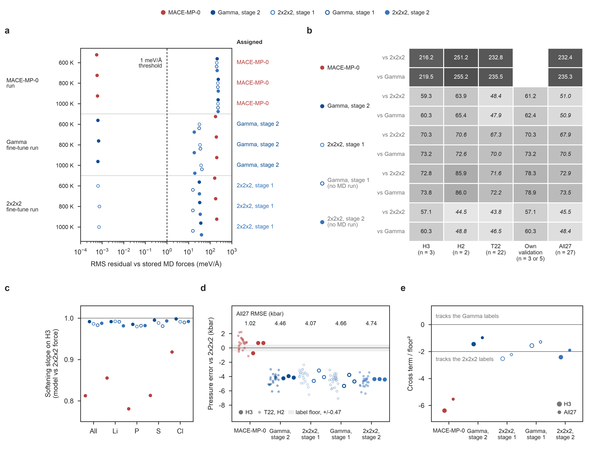

Extended Data Fig. 7 | Model identity and the full cross-evaluation. Markers (legend at top): the universal potentials red (MACE-MP-0 dark, MatterSim light); the fine-tuned models navy (Gamma labels) or blue (2x2x2 labels), filled for stage 2 and open for stage 1. 'Gamma' and '2x2x2' denote MACE-MP-0 small fine-tuned on the Gamma-point labels (22 training and 5 validation configurations) or on the 2x2x2 labels (24 and 3); stage 1 is the best epoch before stochastic weight averaging, stage 2 the model after it. **a**, Force fingerprints of the 416-atom, 200-ps MD runs of MACE-MP-0 and its fine-tunes at 600, 800 and 1000 K (n = 12 runs; both 2x2x2 fine-tune runs, the July run and the run of protocol amendment A5): RMS difference between the forces stored in four frames of each run (first, one third, two thirds, last) and the forces of each candidate MACE model recomputed in float32 on a CPU (logarithmic axis; the markers of a row in the order of the legend, top to bottom). A run is assigned to a model if the residual is below 1 meV/A (dashed line) and every other candidate is at least 10 times worse. The matching model gives 0.0006-0.0007 meV/A, the next best 15.7-227.7 meV/A. Assignments: MACE-MP-0 run -> MACE-MP-0; Gamma fine-tune run -> Gamma, stage 2; July 2x2x2 fine-tune run -> 2x2x2, stage 1; 2x2x2 fine-tune run of amendment A5 -> 2x2x2, stage 2. These are the models of the MACE MD runs in Fig. 3 and Fig. 4 (MACE-MP-0; Gamma, stage 2; 2x2x2, stage 1; 2x2x2, stage 2); Gamma, stage 1 has no MD run. MatterSim is not a candidate: the forces stored in its runs, recomputed with MatterSim, match to 0.0020-0.0021 meV/A (n = 3 runs). Single values, no error bars. In b-e, MatterSim was evaluated in float32 (the precision of its MD runs) and the MACE models in float64 (protocol amendment A4). **b**, Force RMSE (meV/A, all force components of the n configurations under each column) of every model against both label sets on each subset. Own validation is defined for the fine-tunes only: V5 = H3 + H2 for the Gamma fine-tune, H3 for the 2x2x2 fine-tune. Shading is logarithmic in the RMSE. Italic values include configurations the model was trained on; the primary estimand is the H3 column against 2x2x2 (MACE-MP-0 216.2; MatterSim 100.0; Gamma, stage 2 59.3; 2x2x2, stage 2 57.1; Gamma, stage 1 72.8; 2x2x2, stage 1 70.3), as in Fig. 2. Single values, no error bars. **c**, Softening slope (least-squares slope through the origin of model against 2x2x2 force components) on H3, overall and per element (n = 468 components; Li 216, P 36, S 180, Cl 36); the markers of a category in the order of the legend, left to right. MACE-MP-0: all 0.81, Li 0.86, P 0.78, S 0.81, Cl 0.92; MatterSim: all 0.98, Li 1.01, P 0.97, S 0.98, Cl 0.96; fine-tuned models 0.98-1.00. Line, slope 1. Single values, no error bars. **d**, Pressure error against the 2x2x2 labels for each configuration (n = 27 per model; T22 and H2 small and pale below the centre of each model's row, the three H3 configurations large above it), a diagnostic only: no model was trained on stress. Numbers on the right, All27 RMSE (kbar): MACE-MP-0 1.02; MatterSim 1.21; Gamma, stage 2 4.46; 2x2x2, stage 2 4.74; Gamma, stage 1 4.66; 2x2x2, stage 1 4.07. The fine-tuned models underestimate the pressure by 4.0-4.7 kbar on average (mean error of the universal potentials: MACE-MP-0 +0.64; MatterSim +0.76 kbar), well outside the label floor of +/-0.47 kbar (grey band). Single values per configuration, no error bars. **e**, Decomposition of the force error against the two label sets, RMSE(m vs 2x2x2)^2 = RMSE(m vs Gamma)^2 + floor^2 + cross term, over all force components of H3 (large markers; floor 16.3 meV/A) and All27 (small markers; floor 17.2 meV/A); model rows as in d. The cross term divided by floor^2 is 0 for a model whose error against the Gamma labels is uncorrelated with the Gamma minus 2x2x2 difference (it tracks the Gamma labels) and -2 for a model whose error against the 2x2x2 labels is uncorrelated with it (it tracks the 2x2x2 labels). H3 (All27): MACE-MP-0 -6.38 (-5.53); MatterSim -1.30 (-0.61); Gamma, stage 2 -1.44 (-0.97); 2x2x2, stage 2 -2.41 (-1.90); Gamma, stage 1 -1.55 (-1.28); 2x2x2, stage 1 -2.52 (-2.22). The Gamma fine-tunes lie between the two references, closer to 0 on All27, which contains their training configurations; the 2x2x2 fine-tunes lie near -2. Of the universal potentials, trained on neither label set, MatterSim lies between the two references and MACE-MP-0 below -2: the error of MACE-MP-0 against the 2x2x2 labels is anticorrelated with the label difference. Single values, no error bars. Sources: data/models/fingerprints.csv, data/models/mattersim_identity.csv, data/models/evaluation.json, data/models/mattersim_evaluation.json, results/cross_evaluation.csv, results/cross_evaluation_configs.csv, results/label_floor.csv, results/floor_decomposition.csv, data/dft/configs.csv.

## Extended Data Fig. 8. The AIMD reference

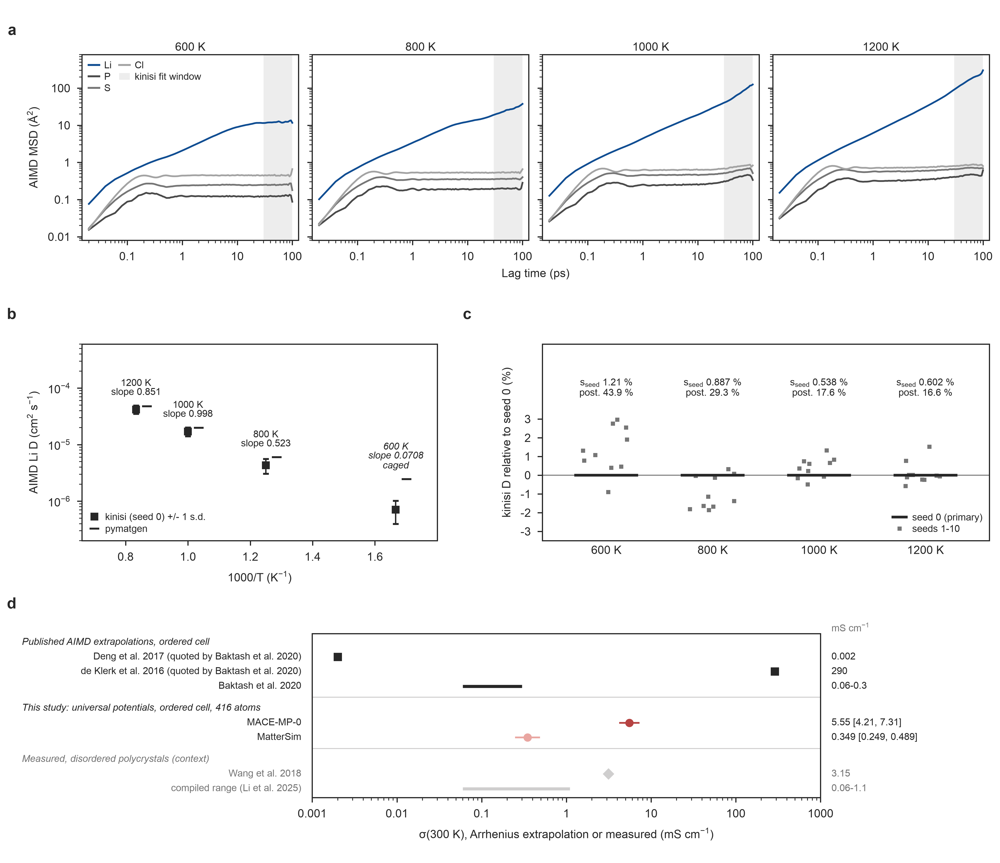

Extended Data Fig. 8 | The AIMD reference. Li transport of every model is compared with ab initio MD (AIMD) of the same ordered Li6PS5Cl cell (Li24P4S20Cl4, Cl on 4a, S on 4c; amendment A3): the trajectories of Deng et al. (Chem. Mater. 29, 281-288, 2017), published with the paper's notebooks (repository materialsvirtuallab/matgenb, commit 2e77d515f23c, BSD-3-Clause license, Copyright (c) 2017 Materials Virtual Lab) and re-analysed here with the estimators and settings of the MLIP runs. From the files: VASP, 52 atoms, time step 2 fs, every 10th step stored, 100 ps at each of 600, 800, 1000 and 1200 K; the exchange-correlation functional and the thermostat are not recorded. Differences from the MLIP runs: lattice parameter 10.10 A against 10.28 A (5.14 % smaller volume), 52 atoms against 416 for the production runs (the 52-atom MLIP runs match the AIMD cell; their ratios to AIMD are in Extended Data Fig. 4), one trajectory per temperature in both. The comparison of the four production models with this reference is Fig. 3. **a**, Mean-squared displacement of Li, P, S and Cl from the single trajectory at each temperature (n = 1; averaged over all time origins, centre-of-mass drift removed; one curve per trajectory, no error bars); grey, the kinisi fit window (lags from 30 % of the run). The framework stays in place: at the longest lag P, S and Cl reach at most 0.612, 0.692 and 0.827 A^2 at any temperature. At 600 K the Li MSD is caged at 11.5-13.5 A^2 across the fit window. **b**, AIMD Li D against 1000/T, one trajectory per temperature: kinisi (seed 0; squares; error bars, the posterior standard deviation; 7.07e-07 +/- 3.10e-07, 4.30e-06 +/- 1.26e-06, 1.70e-05 +/- 3.01e-06, 4.19e-05 +/- 6.96e-06 cm^2/s) and pymatgen (dashes, drawn just right of the squares; no error estimate; 2.45e-06, 6.02e-06, 1.99e-05, 4.77e-05 cm^2/s), in the order 600, 800, 1000, 1200 K. Labels (above each point, below it at 1200 K) give the temperature and the log-log slope of the Li MSD in the fit window (0.0708 at 600 K, 0.523 at 800 K, 0.998 at 1000 K, 0.851 at 1200 K); a slope near 1 is diffusive. At 600 K (slope 0.0708, italic label 'caged') neither estimator measures a diffusion coefficient, so a 600 K ratio to AIMD is not a ratio of diffusion coefficients; the 1200 K run has no MLIP counterpart. **c**, kinisi D for seeds 1-10 (n = 10 per temperature; grey squares, jittered horizontally; single values, no error bars) relative to seed 0 (black bar); they span -1.86 to +2.96 %. s_seed, their relative standard deviation (1.21, 0.887, 0.538, 0.602 %), is 2.75-3.63 % of the posterior width (post., the relative posterior standard deviation of seed 0). **d**, Extrapolated sigma(300 K) of the ordered cell (logarithmic axis). Published AIMD extrapolations (black; squares, single values; bar, a published range) span 5.16 orders of magnitude (0.002 to 290 mS/cm; the first two as quoted in Table 2 of Baktash et al., npj Comput. Mater. 6, 162, 2020). This study's extrapolations for the two universal potentials (416-atom production runs, quoted fits over n = 3 temperatures; bars, the 1-sigma interval of the fit) give MACE-MP-0 5.55 [4.21, 7.31] and MatterSim 0.349 [0.249, 0.489] mS/cm. An extrapolated value is therefore not a usable reference, and models are compared through D at the simulated temperatures. Grey rows: measured room-temperature conductivities of S/Cl-disordered polycrystals (Wang et al. 2018, diamond; range compiled by Li et al. 2025, bar), shown only as context on the same axis; no ratio is formed with them, and the ordered cell is about two orders of magnitude less conductive than the disordered one in AIMD (Baktash et al. 2020). Literature values are printed as given in the sources. Sources: data/references/aimd_deng2017/transport.csv, data/references/aimd_deng2017/kinisi_seeds.csv, data/references/aimd_deng2017/msd.csv.gz, results/fits.csv, data/references/literature.csv, data/md/transport.csv.

## Extended Data Fig. 9. Cl-excess series under MACE-MP-0

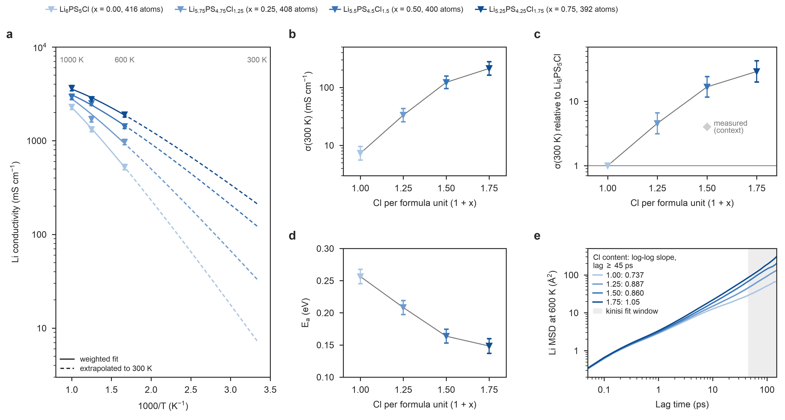

Extended Data Fig. 9 | Cl-excess series under MACE-MP-0. Li(6-x)PS(5-x)Cl(1+x) with x = 0, 0.25, 0.5, 0.75 (Cl 1.00-1.75 per formula unit; 416, 408, 400, 392 atoms), MACE-MP-0, 150-ps runs at 600, 800 and 1000 K. Fits are the quoted values under the reproduction rule (published; the re-analysis reproduces sigma(300 K) to within 0.649 %). Colour, Cl content (light to dark blue, 1.00 to 1.75); inverted triangles, the runs of the series. **a**, Arrhenius plot, n = 3 runs per composition (one per temperature): per-run Nernst-Einstein conductivity from the pymatgen diffusion coefficient with the kinisi standard deviation as error bar, and the weighted fit of ln(sigma T) against 1/T (solid, 600-1000 K; dashed, extrapolated to 300 K); markers are offset by +/-0.05 in 1000/T, alternating with Cl content, so that equal values stay visible; the temperatures of the outer data columns and of the extrapolation target are written above the data. Per-series fits with their residuals are in Extended Data Fig. 3. **b**, sigma(300 K) from the fit over n = 3 temperatures; error bars, the 1-sigma interval of the fit: Cl 1.00, 7.31 [5.58, 9.57] mS/cm; Cl 1.25, 33.2 [25.6, 43.2] mS/cm; Cl 1.50, 123 [95.5, 157] mS/cm; Cl 1.75, 213 [163, 278] mS/cm (logarithmic axis). **c**, Enhancement of sigma(300 K) over Li6PS5Cl (x = 0); error bars, an interval combining the log half-widths of the two fits in quadrature: Cl 1.25, 4.55 [3.12, 6.62]; Cl 1.50, 16.8 [11.6, 24.2]; Cl 1.75, 29.1 [19.9, 42.6]. Grey diamond, labelled 'measured (context)', the measured enhancement of Li5.5PS4.5Cl1.5 over Li6PS5Cl prepared the same way (one measurement pair, no uncertainty given; about 4 times; 9.4 mS/cm, cold-pressed, 298 K; Adeli et al. 2019). The simulated enhancement at Cl 1.50 is 4.19 times the measured one. Logarithmic axis. **d**, Activation energy from the same fits; error bars, +/- 1 s.d. of the fit: 0.256 +/- 0.0112, 0.208 +/- 0.0109, 0.164 +/- 0.0107, 0.148 +/- 0.0114 eV for Cl 1.00 to 1.75. **e**, Li mean-squared displacement of the single 600 K run of each composition (n = 1, averaged over all time origins; no error bars; logarithmic axes); shaded, the kinisi fit window (lag >= 45 ps, 30 % of the run length). Log-log slopes in the window, Cl 1.00 to 1.75: 0.737, 0.887, 0.860, 1.05. MACE-MP-0 is a universal potential, so the measured value is shown here as context; the fine-tuned models are not used in this figure. Sources: results/clexcess.csv, results/fits.csv, data/md/transport.csv, data/md/msd.csv.gz, data/references/literature.csv.
