# Figures

<!-- Generated by `python -m mlipft docs` from results/ and data/; edit src/mlipft/report.py. -->

Main figures in `figures/main/`, Extended Data in `figures/extended/`, each as PDF, SVG (editable text) and 600-dpi PNG; the plotted values of every panel are in `figures/source_data/`. Rebuild with `python -m mlipft figures`.

## Fig. 1. Study design, model system and data

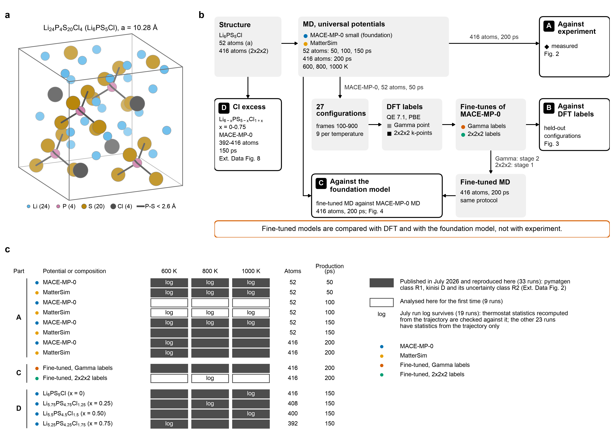

Fig. 1 | Study design, model system and data. **a**, The 52-atom cell of every Li6PS5Cl run (Li24P4S20Cl4, cubic, a = 10.2795 A; the lowest-Ewald-energy S/Cl ordering of the Materials Project cell), in an oblique orthographic projection, farther atoms lighter. The origin is shifted by 0.18 along each axis so that the 4 PS4 tetrahedra (P-S < 2.6 A, minimum image; 16 bonds) lie inside the drawn cell. The 416-atom cell is its 2x2x2 supercell. **b**, Study design. Part A: MD with two universal potentials (MACE-MP-0 small, the foundation model, and MatterSim) at 600, 800, 1000 K, compared with the measured room-temperature conductivity (Fig. 2). Part B: 27 configurations (frames 100-900) of the 52-atom, 50-ps MACE-MP-0 runs were labelled with Quantum ESPRESSO (PBE) at the Gamma point (1 k-point) and on a 2x2x2 mesh (8 k-points); MACE-MP-0 was fine-tuned once on each label set, and the fine-tuned models are compared with these labels (Fig. 3). Part C: MD with the fine-tuned models (the Gamma fine-tune at stage two, the 2x2x2 fine-tune at stage one) under the protocol of the 416-atom, 200-ps foundation runs, compared with those runs (Fig. 4). Part D: the Cl-excess series Li6-xPS5-xCl1+x (x = 0-0.75; 392-416 atoms, 150 ps) with MACE-MP-0 (Extended Data Fig. 8). Fine-tuned models are compared with DFT and with the foundation model, not with experiment. **c**, The 42 MD runs, one per series and temperature. Dark cells: the 33 runs published in July 2026, re-analysed here from the same trajectories (pymatgen class R1 for every run, kinisi class R2; Extended Data Fig. 2). White cells: the 9 runs analysed here for the first time (MACE-MP-0, 52 atoms, 100 ps; MatterSim, 52 atoms, 100 ps; fine-tuned on 2x2x2 labels, 416 atoms, 200 ps). 'log': the July run log survives (19 runs) and the thermostat statistics recomputed from the trajectory were checked against it; for the other 23 runs they come from the trajectory only. Dots, potential (colours as in Figs. 2-4). Sources: data/structures/config0.cif, data/dft/configs.csv, data/dft/qe_runs.csv, results/reproduction_runs.csv, results/thermostat.csv.

## Fig. 2. Universal potentials against experiment

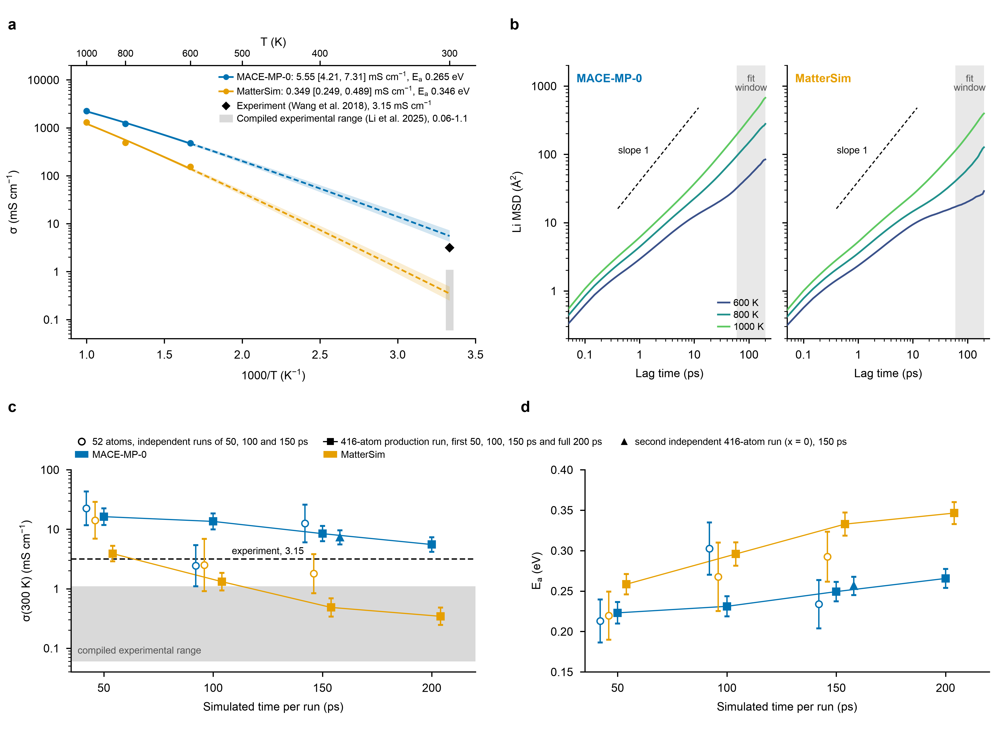

Fig. 2 | Universal potentials against experiment. **a**, Arrhenius plot of the 416-atom, 200-ps production runs at 600, 800 and 1000 K: conductivity of each run from the pymatgen diffusion coefficient (markers; error bars, kinisi 1-sigma uncertainty, which also weights the fit), the quoted weighted fit of ln(sigma T) against 1/T (solid over the simulated range, dashed where extrapolated to 300 K) and its 1-sigma band from the fit covariance; sigma(300 K) = MACE-MP-0 5.55 [4.21, 7.31] mS/cm with Ea = 0.265 +/- 0.012 eV (published value; 1.76 times the measured value) and MatterSim 0.349 [0.249, 0.489] mS/cm with Ea = 0.346 +/- 0.014 eV (published value; 0.11 times the measured value). Black diamond, the measured 3.15 mS/cm of sintered Li6PS5Cl (Wang et al. 2018); grey bar, the range 0.06-1.1 mS/cm compiled by Li et al. (2025). **b**, Li mean-squared displacement (all time origins, cell centre of mass removed) of the same six runs against lag time; grey, the kinisi fit window (lag of at least 60 ps, 30% of the run); dashed line, slope 1. Log-log slopes in the fit window at 600, 800 and 1000 K: MACE-MP-0 0.83, 0.91, 1.04; MatterSim 0.40, 0.96, 1.07. **c**, sigma(300 K) of re-analysis fits against simulated time per run, with 1-sigma intervals: 52-atom cells (open circles; three independent trajectories per potential, MACE-MP-0 22.5, 2.44, 12.5 and MatterSim 14.1, 2.51, 1.79 mS/cm at 50, 100 and 150 ps), the 416-atom production run truncated to its first 50, 100 and 150 ps and in full (squares joined by a line; MACE-MP-0 16.3, 13.5, 8.43, 5.54, MatterSim 3.9, 1.31, 0.485, 0.344 mS/cm), and a second independent 416-atom MACE-MP-0 run (triangle; the x = 0 run of the Cl-excess series, 150 ps, 7.3 mS/cm). Dashed line, the measured value; grey band, the compiled range. Markers at the same simulated time are offset horizontally for legibility. **d**, Activation energy of the same fits with 1-sigma errors (MACE-MP-0 production windows 0.223, 0.231, 0.249, 0.266 eV, MatterSim 0.258, 0.296, 0.333, 0.346 eV). The truncated windows are nested parts of one trajectory and not independent of the full run. Logarithmic axes in a, b and c. Sources: results/fits.csv, results/convergence.csv, data/md/transport.csv, data/md/msd.csv.gz, data/references/literature.csv.

## Fig. 3. Fine-tuned models against their DFT reference

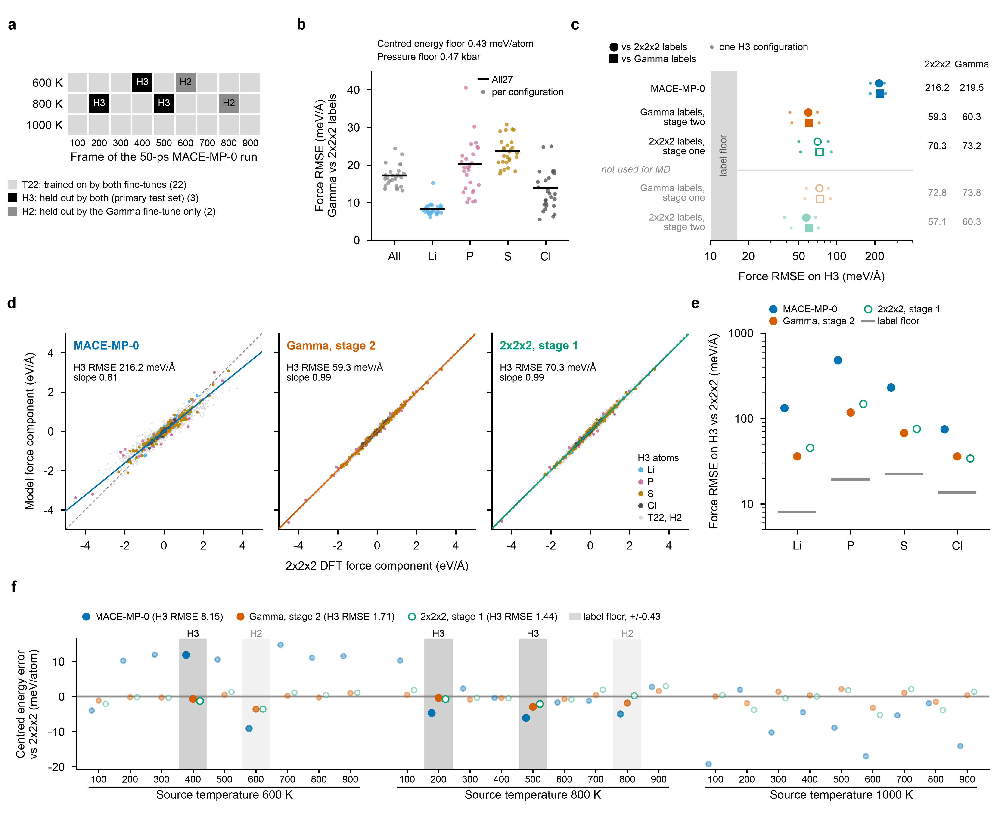

Fig. 3 | Fine-tuned models against their DFT reference. **a**, The 27 DFT-labelled configurations (frames 100-900 of the 52-atom MACE-MP-0 runs at 600, 800 and 1000 K) by subset: T22, used in training by both fine-tunes (22); H3, held out by both (3: T600_f400, T800_f200, T800_f500), the primary test set; H2, held out by the Gamma fine-tune only (2). No 1000 K configuration is held out. **b**, Label-error floor: RMSE of Gamma minus 2x2x2 force components over All27 (17.2 meV/A; Li 8.4, P 20.3, S 23.7, Cl 13.9 meV/A; black bars) and per configuration (dots). Centred energy floor 0.43 meV/atom (the Gamma energies lie on average 5.09 meV/atom above the 2x2x2 ones before centring); pressure floor 0.47 kbar. **c**, Force RMSE on H3 (meV/A): MACE-MP-0 216.2 (2x2x2) and 219.5 (Gamma); Gamma, stage 2 59.3 (2x2x2) and 60.3 (Gamma); 2x2x2, stage 1 70.3 (2x2x2) and 73.2 (Gamma); Gamma, stage 1 72.8 (2x2x2) and 73.8 (Gamma); 2x2x2, stage 2 57.1 (2x2x2) and 60.3 (Gamma). Large markers, all three H3 configurations; small dots, single configurations; grey band, the H3 label floor (16.3 meV/A). Rows above the line are the models that drove the MD runs (identified by force fingerprints, Extended Data Fig. 7a); the two rows below were not used for MD. Logarithmic axis. **d**, Force components predicted by the three MD models against the 2x2x2 labels; H3 atoms coloured by element, the T22 and H2 configurations in grey (T22 is training data of both fine-tunes, H2 of the 2x2x2 fine-tune). Dashed line, identity; solid line, least-squares slope through the origin on H3 (MACE-MP-0 0.81; Gamma, stage 2 0.99; 2x2x2, stage 1 0.99). **e**, Force RMSE on H3 against the 2x2x2 labels per element, with the per-element H3 label floor (grey bars). P carries the largest error (MACE-MP-0 480; Gamma, stage 2 117; 2x2x2, stage 1 148 meV/A). Logarithmic axis. **f**, Energy error per configuration against the 2x2x2 labels after removing each model's constant offset (mean over T22; all configurations have the composition Li24P4S20Cl4), ordered by source temperature. H3 (dark band) and H2 (light band) configurations in full colour, T22 faint. RMSE on H3: MACE-MP-0 8.15; Gamma, stage 2 1.71; 2x2x2, stage 1 1.44 meV/atom (All27: 9.37, 1.43, 2.03 in the same order). The foundation's centred error drifts with source temperature (mean +7.7 at 600 K, -0.4 at 800 K, -8.7 at 1000 K meV/atom). Grey band, the centred label floor. 'Gamma' and '2x2x2' denote MACE-MP-0 small fine-tuned on the Gamma-point labels (22 training and 5 validation configurations) or on the 2x2x2 labels (24 and 3); stage 1 is the best epoch before stochastic weight averaging, stage 2 the model after it. Fine-tuned models are compared with DFT and with the foundation model only. With three held-out configurations no confidence intervals are given. Sources: data/dft/configs.csv, results/label_floor.csv, results/label_floor_configs.csv, results/cross_evaluation.csv, results/cross_evaluation_configs.csv, data/models/predictions_forces.csv.gz.

## Fig. 4. What fine-tuning changes in Li transport

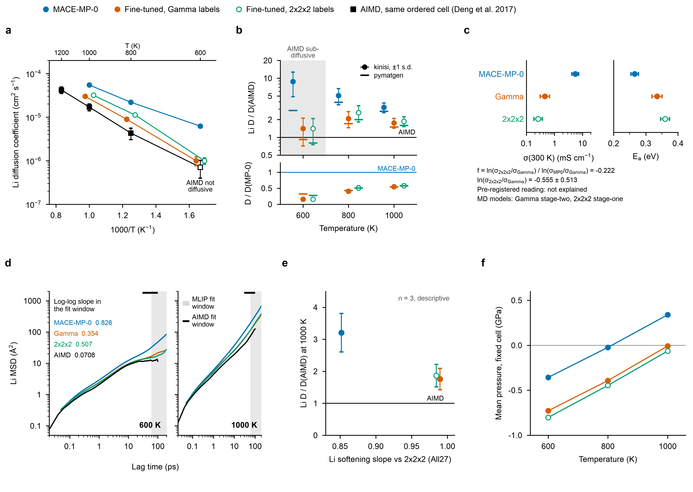

Fig. 4 | What fine-tuning changes in Li transport. All values are re-analysis values of the 416-atom, 200-ps runs at 600, 800 and 1000 K, evaluated in one environment; the fine-tuned models are compared with the foundation model only. The Gamma-label run used the stage-two model and the 2x2x2-label run the stage-one model (identified by force fingerprints, Extended Data Fig. 7a); filled markers, foundation or stage-two model; open markers, stage-one model, as in Fig. 3. **a**, Arrhenius plot: per-run Nernst-Einstein conductivity from the pymatgen diffusion coefficient, with the kinisi standard deviation as error bar, and the fit of ln(sigma T) against 1/T weighted by the kinisi uncertainty (solid, 600-1000 K; dashed, extrapolated to 300 K). Markers at 300 K, sigma(300 K) with the 1-sigma interval from the fit covariance (the two fine-tuned values are offset horizontally for clarity): MACE-MP-0 5.54 [4.18, 7.33] mS/cm and Ea 0.266 +/- 0.0118 eV; Gamma-label run 0.454 [0.309, 0.667] mS/cm and Ea 0.335 +/- 0.0156 eV; 2x2x2-label run 0.260 [0.186, 0.365] mS/cm and Ea 0.360 +/- 0.0139 eV. **b**, Li diffusion coefficient of each fine-tuned run divided by that of the foundation run at the same temperature, from pymatgen (bars) and kinisi (circles; error, the two kinisi relative standard deviations added in quadrature). At 600 K: Gamma-label run 0.324 (pymatgen) and 0.161 +/- 0.0386 (kinisi); 2x2x2-label run 0.281 (pymatgen) and 0.160 +/- 0.0294 (kinisi); at 800 and 1000 K the two estimators differ by at most 0.0281. **c**, sigma(300 K) (logarithmic axis, 1-sigma interval) and Ea (+/- 1 s.d.) of the three fits, and the reading fixed in the analysis plan: f = ln(sigma_2x2x2/sigma_Gamma)/ln(sigma_MP0/sigma_Gamma), the fraction of the fine-tuning slowdown recovered with the 2x2x2 labels (MP0, the foundation run), is -0.222, and ln(sigma_2x2x2/sigma_Gamma) = -0.555 +/- 0.513 (half-widths of the two log intervals in quadrature). Since f < 0.25 the reading is 'not explained': the k-point sampling of the labels does not explain the slowdown. The two runs used models from different training stages, so this comparison is confounded with the training stage. **d**, Li mean-squared displacement at 600 K averaged over all time origins (logarithmic axes); shaded, the kinisi fit window (lag >= 60 ps, 30 % of the run length). Log-log slope of the MSD in the window: MACE-MP-0 0.826, Gamma-label run 0.354, 2x2x2-label run 0.507 (1 for diffusive motion); the fine-tuned runs are not yet diffusive at 600 K, which is where the two estimators in b disagree. **e**, Li force softening slope (least-squares slope through the origin of model against 2x2x2 DFT Li force components on all 27 configurations, All27: MACE-MP-0 0.852, Gamma-label run 0.990, 2x2x2-label run 0.984) against Ea of the MD run driven by the same model (+/- 1 s.d.); n = 3, descriptive only, no fit. Only All27 is shown; on H3 the slopes are 0.855, 0.992, 0.992 in the same order (at most 0.00797 from All27). **f**, Mean pressure of each run in the fixed cell (one cell for all three models) against temperature; markers are the run means. The fine-tuned runs lie 0.347 to 0.446 GPa below the foundation run at the same temperature. The standard deviation of the instantaneous pressure divided by the square root of the number of 0.5-ps blocks (400) is at most 0.0107 GPa, smaller than the markers. Sources: data/md/transport.csv, results/transport_comparison.csv, results/transport_ratios.csv, data/md/msd.csv.gz, results/cross_evaluation.csv, results/thermostat.csv, data/md/timeseries.csv.gz.

## Extended Data Fig. 1. Temperature, energy and pressure of every MD run

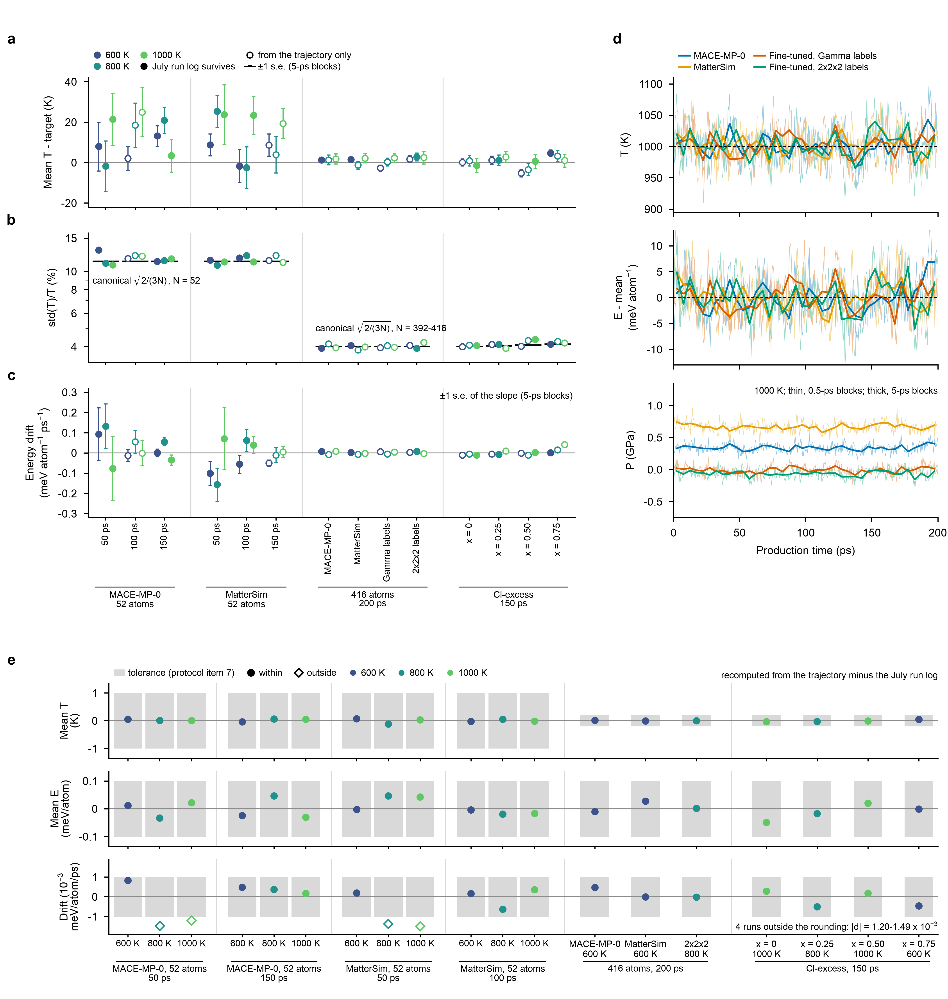

Extended Data Fig. 1 | Temperature, energy and pressure of every MD run. All 42 runs (14 series at 600, 800 and 1000 K; Langevin thermostat, 1 fs step). Filled markers, runs whose July run log survives (19); open markers, statistics recovered from the trajectory only (23). Instantaneous temperature from the kinetic energy with 3N degrees of freedom; pressure -tr(stress)/3 + N k_B T / V. 'Gamma labels' and '2x2x2 labels' are the MACE-MP-0 fine-tunes on the two DFT label sets; x is the Cl excess of Li(6-x)PS(5-x)Cl(1+x). **a**, Mean temperature minus the target. Error bars, standard error of the mean from 5-ps block averages (the standard deviation of the block means divided by the square root of their number). The 52-atom runs lie on average +12.2 K (+1.5 %) from the target (range -2.5 to +25.3 K; 6 of 18 more than two standard errors above it and 0 below), the 392-416-atom runs +0.8 K (+0.1 %; range -5.2 to +4.6 K; 2 of 24 beyond two standard errors). **b**, Relative temperature fluctuation std(T)/T against the canonical value sqrt(2/(3N)) (black bars, for the atom count of each series; logarithmic axis). The ratio of the two is 0.95-1.15 over all runs. **c**, Drift of the potential energy per atom, the slope of a straight-line fit against time over the production run. Error bars, standard error of that slope from 5-ps block averages; 4 of 42 drifts exceed two standard errors (largest 0.156 meV/atom/ps). **d**, Temperature, potential energy per atom (minus its run mean) and pressure of the four 416-atom, 200-ps production runs at 1000 K in 0.5-ps blocks (temperature 910-1096 K). Mean pressure (GPa): MACE-MP-0 +0.34, MatterSim +0.67, Fine-tuned, Gamma labels -0.01, Fine-tuned, 2x2x2 labels -0.06. **e**, Statistics recomputed from the trajectories minus the values in the July run logs, for the 19 runs whose log survives. Grey bands, the tolerance of protocol item 7: |d mean T| <= 1 K for 52 atoms and 0.2 K for 416 atoms (the logs include one extra sample at step 0 and round to 0.1 K); mean energy and drift within one unit of the logged rounding (10^-4 eV/atom and 10^-3 meV/atom/ps). The mean temperature agrees in 19 of 19 runs and the mean energy in 19 of 19. The drift agrees in 15 of 19; it does not in 4 52-atom, 50-ps runs (MACE-MP-0 800 K, MACE-MP-0 1000 K, MatterSim 800 K, MatterSim 1000 K; diamonds), which differ by 1.20-1.49 x 10^-3 meV/atom/ps. The logged fit also includes the production starting frame, which the trajectory does not store; in a 52-atom run this one end point moves the 50-ps slope by about 10^-3 meV/atom/ps. The check is reported as failed, as the rule states. Sources: results/thermostat.csv, data/md/timeseries.csv.gz.

## Extended Data Fig. 2. Re-analysis against the values published in July 2026

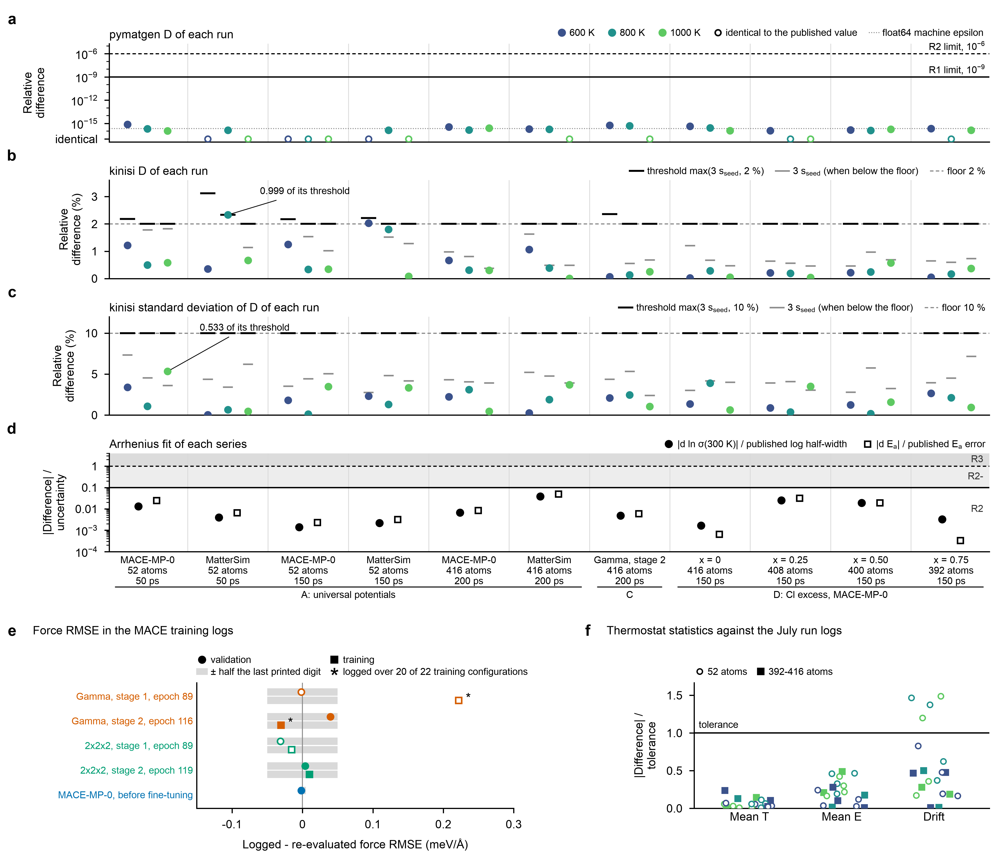

Extended Data Fig. 2 | Re-analysis against the values published in July 2026. The comparison follows a rule committed before any trajectory was re-analysed (protocol/reproduction_rule.md), applied to the 33 published runs of 11 series (x axis of a-d: series in the order of Fig. 1c, three runs each at 600, 800 and 1000 K, coloured by temperature). **a**, Relative difference between the re-analysed and the published pymatgen D of each run. In 12 runs the two are bit-identical (open circles, drawn at 1e-17); the others differ by 1.1e-16-7.3e-16, a few float64 rounding steps (dotted line, machine epsilon 2.22e-16). Solid line, the R1 limit (1e-9); dashed line, the R2 limit (1e-6). Classes: R1 for every run in D and in sigma. **b**, Relative difference of the kinisi D (seed 0 here, an unseeded sampler in July) and **c**, of its kinisi standard deviation, with each run's threshold max(3 s_seed, 2 %) and max(3 s_seed, 10 %) (black bars), where s_seed is the relative scatter of seeds 1-10 (grey bars, 3 s_seed when below the floor; dashed line, the floor). Within the threshold: 33 of 33 runs in b and 33 of 33 in c (class R2). The closest is MatterSim, 52 atoms, 50 ps at 800 K in b (2.331 % against 2.332 %, 0.9994 of the threshold) and MACE-MP-0, 52 atoms, 50 ps at 1000 K in c (0.533 of the threshold); in c, 3 s_seed never exceeds 7.36 %, so the 10 % floor sets every threshold. **d**, The 11 Arrhenius fits re-done with the re-analysed values: |d ln sigma(300 K)| in units of the published log half-width of the 1-sigma interval (filled circles) and |d Ea| in units of the published Ea error (open squares). Solid line, the R2 limit (0.1); dashed line, the R2- limit (1). Classes: R2; the largest difference is 0.050 (MatterSim, 416 atoms, 200 ps). The published values are therefore quoted for these series (rule item 2). **e**, Force RMSE written in the MACE training logs minus the same error re-evaluated from the model files (meV/A), for the four fine-tuned models (stage 1 open, stage 2 filled; colours as in Fig. 3) and the foundation model before fine-tuning (validation set of the Gamma fine-tune). Grey bars, half the last printed digit. Validation errors agree to within 0.040 meV/A. The logged training errors of the Gamma fine-tune (asterisks) cover 20 of its 22 training configurations because MACE drops the last incomplete batch (protocol amendment A1); against all 22 they differ by +0.22 and -0.03 meV/A, and 11 (stage 1) and 21 (stage 2) of the 231 subsets of 20 configurations reproduce the logged values exactly. **f**, Thermostat statistics recomputed from the trajectory against the 19 surviving July run logs (4 of them belong to runs never analysed in July): absolute difference in units of the tolerance of the rule (0.2 K for 392-416 atoms and 1 K for 52 atoms for the mean temperature; one unit of the logged rounding, 0.0001 eV/atom and 0.001 meV/atom/ps, for the mean energy and the drift); colour, temperature; circles, 52 atoms; squares, 392-416 atoms. The mean temperature agrees in 19 of 19 runs and the mean energy in 19 of 19; the drift agrees in 15 of 19. The 4 drift values outside the tolerance (mace_52_050_800K, mace_52_050_1000K, mattersim_52_050_800K, mattersim_52_050_1000K; at most 0.0015 meV/atom/ps) are all from 52-atom, 50-ps runs, where the logged fit also includes the starting frame that the trajectory does not store; the check is reported as failed, as the rule states. Sources: results/reproduction_runs.csv, results/reproduction_fits.csv, results/thermostat.csv, data/models/log_reproduction.csv, data/dft/configs.csv, protocol/reproduction_rule.md, protocol/amendments.md.

## Extended Data Fig. 3. Arrhenius fits of every series

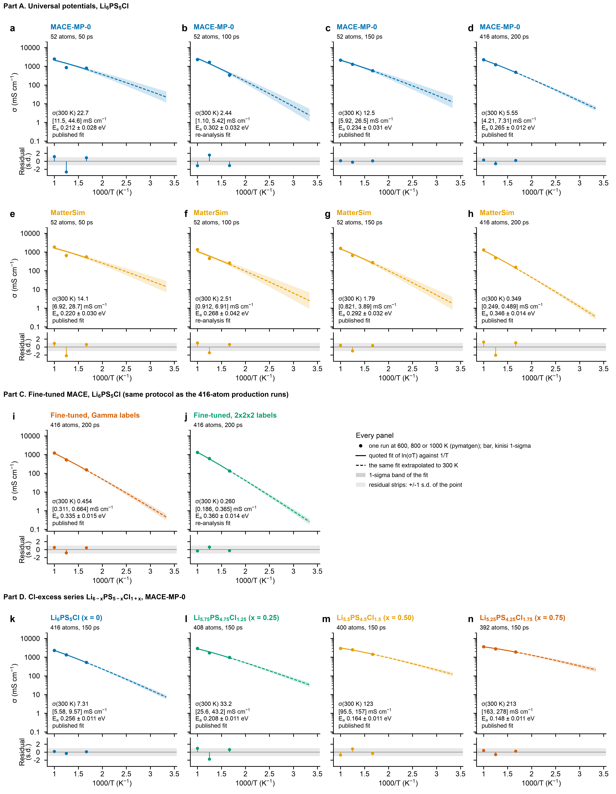

Extended Data Fig. 3 | Arrhenius fits of every series. **a-n**, One panel per MD series, grouped by part: **a-h**, the universal potentials on Li6PS5Cl (part A; MACE-MP-0 top row, MatterSim second row; 52-atom cells run for 50, 100 and 150 ps, which are independent trajectories, and the 416-atom, 200-ps production runs); **i**, **j**, the two fine-tuned models under the production protocol (part C); **k-n**, the Cl-excess series Li(6-x)PS(5-x)Cl(1+x) under MACE-MP-0 with x = 0, 0.25, 0.50 and 0.75 (part D). Markers, conductivity of each run at 600, 800 and 1000 K from the pymatgen diffusion coefficient (Nernst-Einstein, no Haven ratio); error bars, the kinisi 1-sigma uncertainty, whose ratio to sigma weights the fit of ln(sigma T) against 1/T. Line, the quoted fit (solid over the simulated range, dashed where extrapolated to 300 K) with its 1-sigma band from the fit covariance; the value printed in each panel is sigma(300 K) with its 1-sigma interval and Ea with its 1-sigma error. The quoted fit is the published one for every series analysed in July 2026 and the re-analysis otherwise (MACE-MP-0, 52 atoms, 100 ps; MatterSim, 52 atoms, 100 ps; Fine-tuned on 2x2x2 labels, 416 atoms, 200 ps). Strips, residual ln sigma minus the quoted fit at each temperature in units of that point's ln-space uncertainty (kinisi standard deviation over sigma, from the re-analysis also for the published fits); grey band, +/-1. With three temperatures and two parameters each fit has one degree of freedom; the largest residual is -2.68 (MACE-MP-0, 52 atoms, 50 ps, 800 K). Shared logarithmic conductivity axis in all panels. Sources: results/fits.csv, data/md/transport.csv.

## Extended Data Fig. 4. Sampling and estimator checks

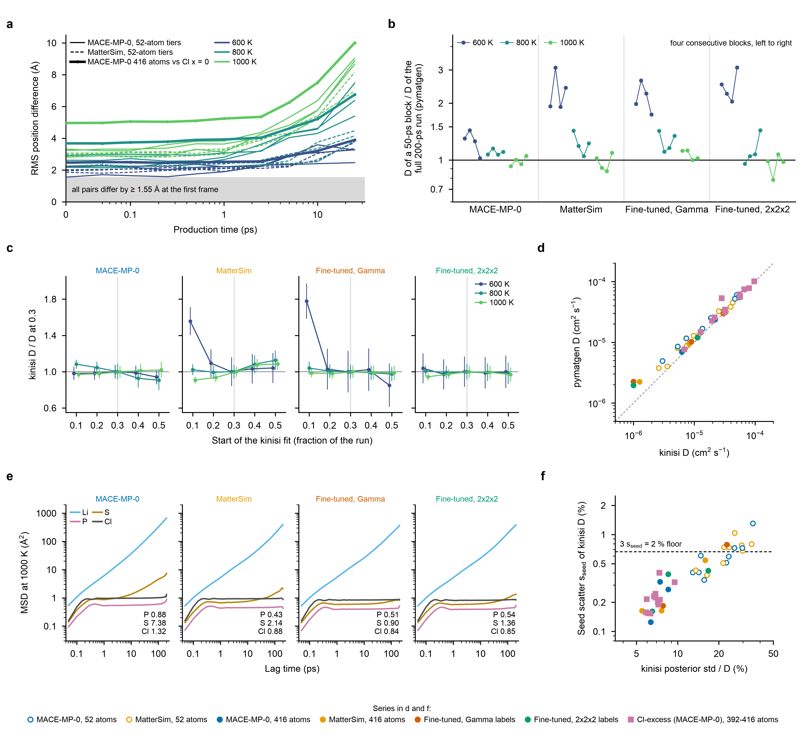

Extended Data Fig. 4 | Sampling and estimator checks. **a**, Root-mean-square difference of the atomic positions between two runs with the same potential, cell and temperature, against production time: the 52-atom runs of 50, 100 and 150 ps of each universal potential (three pairs per potential and temperature) and the 416-atom, 200-ps MACE-MP-0 production run against the 416-atom Cl-excess x = 0 run (thick lines). Positions are stored at frames 0, 1, 2, 5, 10, 20, 50, 100, 200 and 500 (one frame every 50 fs); the axis is linear below 0.05 ps and logarithmic above. At the first production frame the pairs already differ by 1.55-3.32 A (52 atoms) and 2.46-4.96 A (416 atoms), and by 2.46-10.00 A after 25 ps, so the runs are independent trajectories and not extensions of one another. **b**, pymatgen D of the four consecutive 50-ps blocks of each 416-atom, 200-ps production run divided by the value from the full run (blocks in time order from left to right; logarithmic axis). The ratio is 1.02-3.09 at 600 K; 0.95-1.44 at 800 K; 0.78-1.12 at 1000 K. At 600 K the slower models give block values well above the full-run value, i.e. pymatgen D still depends on the length of the analysed window there. **c**, kinisi D with the fit window starting at 10-50 % of the run, divided by the primary value (start at 30 %, grey line); error bars, kinisi posterior standard deviation divided by the same primary value. Above 600 K the ratio stays within 0.91-1.13; the largest change is 1.78 (Fine-tuned on Gamma labels, 416 atoms, 200 ps, 600 K, start 0.1). **d**, pymatgen D against kinisi D for all 42 runs (dashed line, equality). pymatgen D / kinisi D is 1.00-2.26 at 600 K; 1.07-1.89 at 800 K; 0.96-1.29 at 1000 K (largest 2.26, Fine-tuned on Gamma labels, 416 atoms, 200 ps, 600 K). **e**, Mean-squared displacement of Li, P, S and Cl (all time origins, centre-of-mass drift removed) in the four production runs at 1000 K. At the longest lag (199.95 ps, a single time origin) Li reaches at least 368 A^2, P at most 0.88 A^2 and Cl at most 1.32 A^2: the P framework and the Cl sublattice stay in place. S reaches MACE-MP-0 7.38, MatterSim 2.14, Fine-tuned, Gamma 0.90, Fine-tuned, 2x2x2 1.36 A^2 (values printed in each panel); S moving further than P is consistent with reorientation of PS4 tetrahedra about fixed P. **f**, Monte-Carlo scatter of kinisi D, s_seed = relative standard deviation of D over seeds 1-10 (seed 0 is the primary value), against the relative width of the kinisi posterior (seed 0). The reproduction rule accepts a kinisi D within max(3 s_seed, 2 %); above the dashed line (0.667 %) the seed term sets the tolerance, which is the case in 10 of 42 runs. s_seed is 0.12-1.30 %, 0.020-0.055 times the posterior width. Sources: data/md/divergence.csv, data/md/windows.csv, data/md/transport.csv, data/md/msd.csv.gz, data/md/kinisi_seeds.csv.

## Extended Data Fig. 5. The two DFT label sets

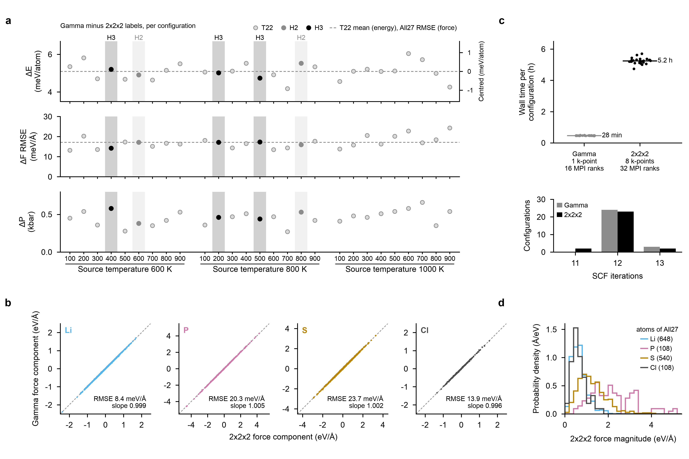

Extended Data Fig. 5 | The two DFT label sets. Both sets label the same 27 configurations with Quantum ESPRESSO 7.1 (GBRV ultrasoft PBE pseudopotentials, 60/480 Ry, Gaussian smearing 0.01 Ry, convergence threshold 1e-7 Ry) and differ only in the k-point sampling: Gamma point only, or a 2x2x2 Monkhorst-Pack mesh (taken as the better reference). **a**, Gamma minus 2x2x2 per configuration, ordered by source temperature and frame: energy per atom (left axis raw, 4.18 to 6.04 meV/atom; right axis after subtracting the T22 mean of 5.09 meV/atom, dashed line), force RMSE over all components (dashed line, All27 value 17.2 meV/A; largest 24.3 meV/A for T1000_f900) and pressure (RMSE 0.47 kbar; the Gamma pressure is the higher one for every configuration). Shaded columns, H3 (dark) and H2 (light). **b**, Gamma against 2x2x2 force components for all atoms of the 27 configurations, by element: RMSE (meV/A) Li 8.4 (slope 0.999), P 20.3 (slope 1.005), S 23.7 (slope 1.002), Cl 13.9 (slope 0.996). Dashed line, identity. **c**, Cost of the SCF single points: wall time per configuration (median 28 min with 1 k-point on 16 MPI processes; 5.2 h with 8 k-points on 32 processes; 200 and 4525 core-hours for the 27 configurations) and the number of SCF iterations (12-13 and 11-13). The 2x2x2 wall and CPU times are printed by Quantum ESPRESSO in hours and minutes, so they are resolved to 1 min. **d**, Distribution of the 2x2x2 force magnitudes per element over all 27 configurations (mean Li 0.68, P 2.22, S 1.26, Cl 0.66 eV/A); the Gamma distributions are indistinguishable at this scale (mean magnitudes differ by at most 11.4 meV/A). Sources: data/dft/configs.csv, data/dft/qe_runs.csv, data/dft/pseudopotentials.csv, results/label_floor.csv, results/label_floor_configs.csv, data/models/predictions_forces.csv.gz.

## Extended Data Fig. 6. Training records of the two fine-tunes

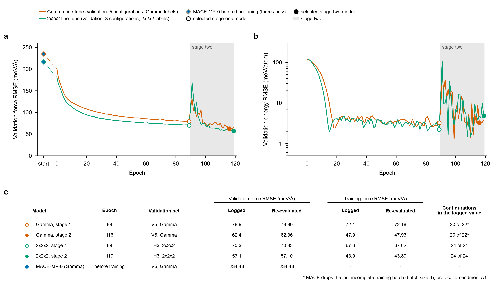

Extended Data Fig. 6 | Training records of the two fine-tunes. Both start from MACE-MP-0 small with the same settings (batch size 4; stage one with energy and force loss weights 1 and 10 and learning rate 0.0001; stage two, from epoch 90 (shaded), with weights 1000 and 100, learning rate 0.001 and stochastic weight averaging). **a**, Validation force RMSE and **b**, validation energy RMSE per atom against epoch, as written by MACE. The two curves use different validation sets and different labels and are not directly comparable: the Gamma fine-tune is validated on 5 configurations (V5 = H3 + H2) against the Gamma labels, the 2x2x2 fine-tune on 3 (H3) against the 2x2x2 labels. Diamonds, the foundation model before fine-tuning on the same validation sets (234.4 and 216.2 meV/A). The energy error before training is not shown because it is an absolute energy error of the foundation model (it depends on the reference energies), which this study does not report. Open circles, the selected stage-one models (epoch 89 for both; 78.9 and 70.3 meV/A); filled circles, the selected stage-two models (epochs 116 and 119; 62.4 and 57.1 meV/A). The switch to the stage-two weights and learning rate raises the force error transiently (to 131 and 168 meV/A). **c**, Errors in the training logs against the same errors re-evaluated from the model files in float64 on a CPU. Validation errors agree to within 0.04 meV/A (the logs print one decimal). The logged training errors of the Gamma fine-tune cover 20 of its 22 training configurations, because MACE drops the last incomplete batch of the shuffled training loader (asterisks; protocol amendment A1): 11 and 21 of the 231 subsets of 20 configurations reproduce the logged stage-one and stage-two values. The 2x2x2 fine-tune has 24 training configurations, a multiple of the batch size, and its logged training errors cover all of them. Model names as in Fig. 3. Sources: data/models/training/ftG_record.jsonl, data/models/training/ftK_record.jsonl, data/models/evaluation.json, data/models/log_reproduction.csv, data/dft/configs.csv.

## Extended Data Fig. 7. Model identity and the full cross-evaluation

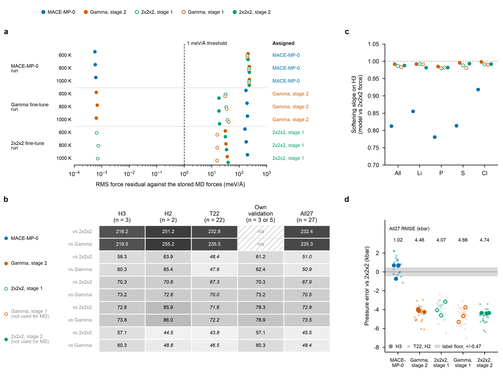

Extended Data Fig. 7 | Model identity and the full cross-evaluation. **a**, Force fingerprints of the 416-atom, 200-ps MD runs at 600, 800 and 1000 K: RMS difference between the forces stored in four frames of each run (first, one third, two thirds, last) and the forces of each candidate model recomputed in float32 on a CPU (logarithmic axis). A run is assigned to a model if the residual is below 1 meV/A (dashed line) and every other candidate is at least 10 times worse. The matching model gives 0.0006-0.0007 meV/A, the next best 15.7-227.7 meV/A. Assignments: MACE-MP-0 run -> MACE-MP-0; Gamma fine-tune run -> Gamma, stage 2; 2x2x2 fine-tune run -> 2x2x2, stage 1. These three models are the primary rows of Fig. 3; the other two fine-tuned models were not used for MD. **b**, Force RMSE (meV/A) of all five models against both label sets on each subset (own validation: V5 = H3 + H2 for the Gamma fine-tune, H3 for the 2x2x2 fine-tune; not applicable to the foundation). Shading is logarithmic in the RMSE. Italic values include configurations the model was trained on; the primary estimand is the H3 column against 2x2x2 (MACE-MP-0 216.2; Gamma, stage 2 59.3; 2x2x2, stage 1 70.3; Gamma, stage 1 72.8; 2x2x2, stage 2 57.1). **c**, Softening slope (least-squares slope through the origin of model against 2x2x2 force components) on H3, overall and per element. MACE-MP-0: all 0.81, Li 0.86, P 0.78, S 0.81, Cl 0.92; fine-tuned models 0.98-1.00. Dashed line, slope 1. **d**, Pressure error against the 2x2x2 labels for each configuration (H3 large and opaque), a diagnostic only: no model was trained on stress. All27 RMSE (kbar): MACE-MP-0 1.02; Gamma, stage 2 4.46; 2x2x2, stage 1 4.07; Gamma, stage 1 4.66; 2x2x2, stage 2 4.74. The fine-tuned models underestimate the pressure by 4.0-4.7 kbar on average (MACE-MP-0: +0.64 kbar), well outside the label floor of 0.47 kbar (grey band). Model names as in Fig. 3; stage 2 filled, stage 1 open markers. Sources: data/models/fingerprints.csv, results/cross_evaluation.csv, results/cross_evaluation_configs.csv, results/label_floor.csv, data/dft/configs.csv.

## Extended Data Fig. 8. Cl-excess series under MACE-MP-0

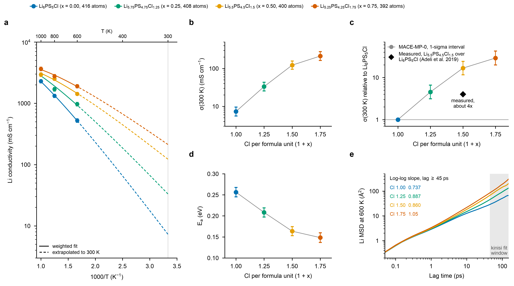

Extended Data Fig. 8 | Cl-excess series under MACE-MP-0. Li(6-x)PS(5-x)Cl(1+x) with x = 0, 0.25, 0.5, 0.75 (Cl 1.00-1.75 per formula unit; 416, 408, 400, 392 atoms), MACE-MP-0, 150-ps runs at 600, 800 and 1000 K. Fits are the quoted values under the reproduction rule (published; the re-analysis reproduces sigma(300 K) to within 0.649 %). **a**, Arrhenius plot: per-run Nernst-Einstein conductivity from the pymatgen diffusion coefficient with the kinisi standard deviation as error bar, and the weighted fit of ln(sigma T) against 1/T (solid, 600-1000 K; dashed, extrapolated to 300 K). **b**, sigma(300 K) with the 1-sigma interval of the fit: Cl 1.00, 7.31 [5.58, 9.57] mS/cm; Cl 1.25, 33.2 [25.6, 43.2] mS/cm; Cl 1.50, 123 [95.5, 157] mS/cm; Cl 1.75, 213 [163, 278] mS/cm (logarithmic axis). **c**, Enhancement of sigma(300 K) over Li6PS5Cl (x = 0), with an interval combining the log half-widths of the two fits in quadrature: Cl 1.25, 4.55 [3.12, 6.62]; Cl 1.50, 16.8 [11.6, 24.2]; Cl 1.75, 29.1 [19.9, 42.6]. Black diamond, the measured enhancement of Li5.5PS4.5Cl1.5 over Li6PS5Cl prepared the same way (about 4 times; 9.4 mS/cm, cold-pressed, 298 K; Adeli et al. 2019). The simulated enhancement at Cl 1.50 is 4.19 times the measured one. Logarithmic axis. **d**, Activation energy (+/- 1 s.d.): 0.256 +/- 0.0112, 0.208 +/- 0.0109, 0.164 +/- 0.0107, 0.148 +/- 0.0114 eV for Cl 1.00 to 1.75. **e**, Li mean-squared displacement at 600 K averaged over all time origins (logarithmic axes); shaded, the kinisi fit window (lag >= 45 ps, 30 % of the run length). Log-log slopes in the window, Cl 1.00 to 1.75: 0.737, 0.887, 0.860, 1.05. MACE-MP-0 is a universal potential, so the comparison with a measured value is made here; the fine-tuned models are not used in this figure. Sources: results/clexcess.csv, results/fits.csv, data/md/transport.csv, data/md/msd.csv.gz, data/references/literature.csv.
